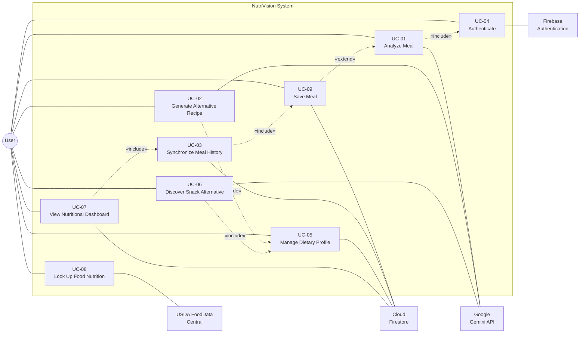

# 2. Use Case Diagram & Descriptions

> Deliverable §4.1 (partial) of the trainer's guidelines. GitHub issue #3.

---

## 2.1 Actors

| Actor | Type | Description | Source |
|-------|------|-------------|--------|
| **User** | Primary, human | A person recording and reviewing meals. The only human actor; the system has no role hierarchy and no administrator. | `[E: S3 — every use case lists "Actor: User"]` |
| **Google Gemini API** | Secondary, external system | Performs meal analysis, recipe generation and snack-alternative reasoning. | `[E: team decision, 2026-11-04]` — S1/S2/S3 say only "AI service" / "LLM REST endpoints" |
| **USDA FoodData Central** | Secondary, external system | Provides reference nutritional data for food lookup and search suggestions. | `[U]` — see OI-04 |
| **Firebase Authentication** | Secondary, external system | Verifies user identity via email/password and Google Sign-In. | `[E: team decision, 2026-11-04]`; service named in S5 (Kamel's module) |
| **Cloud Firestore** | Secondary, external system | Stores and synchronizes user data across devices. | `[E: S1 §1 OBJ-07; S3 FR-10, UC-03]` |

> There is no administrator actor. Issue #1 explicitly excludes an admin portal.

---

## 2.2 Use case diagram

**Diagram note.** Mermaid has no native UML use-case notation. Ellipses are rendered as rounded boxes inside the system boundary, actors as circles and external systems as plain boxes. Solid lines are associations; dashed lines carry `«include»` / `«extend»` stereotypes. This is a faithful representation of UML semantics in an open, diffable source format.

---

## 2.3 Use case descriptions

### Evidence-based use cases

The following three are reproduced from S3 §3 with their original flows preserved. Alternate flows marked `[P]` are author additions required by FR-11, FR-14 and FR-15, which S3 states as requirements but does not express as use-case steps.

---

#### UC-01 — Analyze Meal `[E: S3 §3]`

| Field | Value |
|-------|-------|
| **Actor** | User (primary); Google Gemini API (secondary) |
| **Precondition** | The user has entered a meal description. |
| **Includes** | UC-04 (Authenticate) `[P]` |
| **Requirements** | FR-01, FR-02, FR-03, FR-11, FR-14, FR-15 |
| **User stories** | US-01, US-02 |

**Main flow** `[E]`
1. User opens NutriVision.
2. User enters a meal description.
3. User submits the meal.
4. Application validates the input.
5. Application sends the request to the AI service.
6. AI analyzes the meal.
7. Application displays nutritional recommendations.
8. User can save the meal.

**Postcondition** `[E]` — The meal analysis is displayed and can be stored in the user's history.

**Alternate flows** `[P]`
- **A1 — Invalid input.** At step 4, if the description is empty or below the minimum length, the application displays a validation message and returns to step 2. *(FR-14)*
- **A2 — AI service unavailable.** At step 5, if the request times out or returns a transport error, the application displays a controlled error state offering retry. The meal is not saved. *(FR-11, NFR-02, NFR-08)*
- **A3 — Malformed AI response.** At step 6, if the response does not conform to the expected JSON schema, the application treats it as a failed analysis and offers retry. *(S5 — Ahmed's module: "handles error recovery for malformed AI responses")*
- **A4 — Offline.** If no network connection exists at step 3, the application displays an offline banner and does not submit. *(S5 — Mahmoud's module: offline banner)*

---

#### UC-02 — Generate Alternative Recipe `[E: S3 §3]`

| Field | Value |
|-------|-------|
| **Actor** | User (primary); Google Gemini API (secondary) |
| **Precondition** | Meal information is available. |
| **Includes** | UC-05 (Manage Dietary Profile) — restrictions are read into the prompt |
| **Requirements** | FR-04, FR-05, FR-06, FR-11, FR-15 |
| **User stories** | US-03, US-04 |

**Main flow** `[E]`
1. User selects a meal.
2. User requests an alternative recipe.
3. The user's dietary restrictions are included in the AI prompt.
4. AI generates a healthier alternative.
5. Application displays the recipe.

**Postcondition** `[P]` — A recipe is displayed and may be saved to the user's recipes.

**Alternate flows** `[P]`
- **A1 — No dietary profile set.** At step 3, if the user has no stored restrictions, the prompt is built without them and the UI indicates that recommendations are not personalised.
- **A2 — Generation failure.** As UC-01 A2 / A3.

---

#### UC-03 — Synchronize Meal History `[E: S3 §3]`

| Field | Value |
|-------|-------|
| **Actor** | User (primary); Cloud Firestore (secondary) |
| **Precondition** | `[P]` User is authenticated. |
| **Includes** | UC-09 (Save Meal) |
| **Requirements** | FR-07, FR-08, FR-10, NFR-09 |
| **User stories** | US-05, US-06 |
| **Owner** | Kamel's module — **currently unassigned, see OI-05** |

**Main flow** `[E]`
1. User saves a meal.
2. Application stores the meal through its data layer.
3. Data is synchronized with Firebase Cloud Firestore.
4. User accesses the application from another device.
5. Application retrieves the synchronized meal data.

**Postcondition** `[P]` — Meal history is identical on all of the user's authenticated devices.

**Alternate flows** `[P]`
- **A1 — Offline save.** At step 3, if no connection exists, the meal is written to the local cache and queued. Firestore's offline persistence reconciles on reconnection. *(S5 — "handles local cache persistence for offline meal entry")*
- **A2 — Sync failure.** A synchronization failure produces a controlled error state and does not crash the application. *(NFR-09)*

---

### Proposed use cases

> `[P]` **The following six use cases are proposed, not approved.** They are derived from functional requirements, user stories and module descriptions that exist in the evidence base but were never written up as use cases in S3. They are required for the use-case diagram to cover FR-01…FR-15 plus the authentication decision. Each cites the evidence it is derived from. None may be treated as agreed until the team approves this document.

#### UC-04 — Authenticate `[P]`

| Field | Value |
|-------|-------|
| **Actor** | User (primary); Firebase Authentication (secondary) |
| **Derived from** | Team decision 2026-11-04; Firebase Authentication named in S5 (Kamel's module); required by US-05/US-06 (per-user history) and NFR-05 (security rules restricting unauthorized access) |
| **Requirements** | FR-16, FR-17, FR-18, FR-19 (proposed) |
| **Precondition** | The application is installed and has network access. |

**Main flow**
1. User opens the application and is not authenticated.
2. Application displays the login screen.
3. User chooses email/password or Google Sign-In.
4. User supplies credentials or completes the Google consent flow.
5. Firebase Authentication verifies the identity and returns a UID.
6. Application establishes the session and routes to the dashboard.

**Postcondition** — A UID is available; all Firestore reads and writes are scoped to it.

**Alternate flows**
- **A1 — Invalid credentials.** Error displayed, return to step 3.
- **A2 — Registration.** At step 3 a new user selects register; the application creates the account and proceeds to onboarding (UC-05).
- **A3 — Google flow cancelled.** Return to step 2 with no error state.

> **Note.** No "forgot password" flow is documented anywhere in the evidence base. Flagged as OI-06.

---

#### UC-05 — Manage Dietary Profile `[P]`

| Field | Value |
|-------|-------|
| **Actor** | User (primary); Cloud Firestore (secondary) |
| **Derived from** | US-03 "I want to specify my dietary restrictions"; FR-05; S5 — Ahmed's module ("allergen toggles") |
| **Requirements** | FR-05 |
| **Precondition** | User is authenticated. |

**Main flow**
1. User opens settings or onboarding.
2. Application displays dietary restrictions and allergen toggles.
3. User selects applicable restrictions.
4. Application persists the profile to Firestore.

**Postcondition** — Restrictions are available to every subsequent AI prompt (UC-01, UC-02, UC-06).

---

#### UC-06 — Discover Snack Alternative `[P]`

| Field | Value |
|-------|-------|
| **Actor** | User (primary); Google Gemini API (secondary) |
| **Derived from** | FR-06 "suggest healthier alternatives to meals or snacks"; S5 — Osama's module (`SnackDiscoveryScreen`, craving-vs-alternative comparison cards, bookmarking, ingredient substitution) |
| **Requirements** | FR-06, FR-05, FR-15 |
| **Precondition** | User is authenticated. |

**Main flow**
1. User enters a craving (e.g. a snack they want).
2. Application builds a discovery prompt including dietary restrictions and macro goals.
3. Gemini returns a healthier alternative.
4. Application displays the craving and the alternative side by side.
5. User may bookmark the alternative.

**Postcondition** — A bookmarked alternative is persisted and synchronized.

---

#### UC-07 — View Nutritional Dashboard `[P]`

| Field | Value |
|-------|-------|
| **Actor** | User (primary); Cloud Firestore (secondary) |
| **Derived from** | US-07; FR-09; S5 — Bassam's module (`NutritionalDashboardScreen`, calorie progress rings, macro breakdown charts, daily summation algorithms) |
| **Requirements** | FR-09, NFR-01, NFR-07 |
| **Precondition** | User is authenticated and has at least one saved meal. |

**Main flow**
1. User opens the dashboard.
2. Application reads saved meals for the selected period.
3. Application computes daily calorie and macro totals against targets.
4. Application renders progress rings and breakdown charts.

**Alternate flow** — **A1 — No data.** An empty state is displayed instead of empty charts.

---

#### UC-08 — Look Up Food Nutrition `[P]` `[U]`

| Field | Value |
|-------|-------|
| **Actor** | User (primary); USDA FoodData Central (secondary) `[U]` |
| **Derived from** | S5 — Mahmoud's module (`NutritionalLookupScreen` with "real-time search inputs and live suggestion lists") |
| **Requirements** | FR-11, FR-12, FR-13, FR-15 |
| **Precondition** | User is authenticated. |

**Main flow**
1. User types a food name into the search field.
2. Application debounces the input and queries the nutrition database.
3. Application displays live suggestions.
4. User selects an item.
5. Application displays reference nutritional values.

> **This use case depends entirely on OI-04.** If no separate nutrition database is used, UC-08 is either removed or re-pointed at Gemini, and `10-api-documentation.md` changes accordingly. Nothing downstream should be built on UC-08 until OI-04 is resolved.

---

#### UC-09 — Save Meal `[P]`

| Field | Value |
|-------|-------|
| **Actor** | User (primary); Cloud Firestore (secondary) |
| **Derived from** | FR-07; UC-01 step 8 ("User can save the meal") — present in S3 as a step but never elaborated |
| **Requirements** | FR-07, KPI-08 |
| **Extends** | UC-01 |

**Main flow**
1. User confirms saving an analyzed meal.
2. Application writes the meal and its analysis through the data layer.
3. UC-03 synchronization is triggered.

**Postcondition** — The meal appears in history (US-05) and contributes to the dashboard (UC-07).

---

## 2.4 Use case to requirement coverage

| Use case | Requirements covered |
|----------|---------------------|
| UC-01 | FR-01, FR-02, FR-03, FR-11, FR-14, FR-15 |
| UC-02 | FR-04, FR-05, FR-06, FR-11, FR-15 |
| UC-03 | FR-07, FR-08, FR-10 |
| UC-04 `[P]` | FR-16, FR-17, FR-18, FR-19 `[P]` |
| UC-05 `[P]` | FR-05 |
| UC-06 `[P]` | FR-05, FR-06, FR-15 |
| UC-07 `[P]` | FR-09 |
| UC-08 `[P]` `[U]` | FR-11, FR-12, FR-13, FR-15 |
| UC-09 `[P]` | FR-07 |

Every requirement FR-01…FR-15 is covered by at least one use case. FR-12 (Dio interceptors) and FR-13 (responsive layouts) are cross-cutting and realised across all network-bound and all screen use cases respectively; they are attributed to UC-08 above only to show first coverage.
