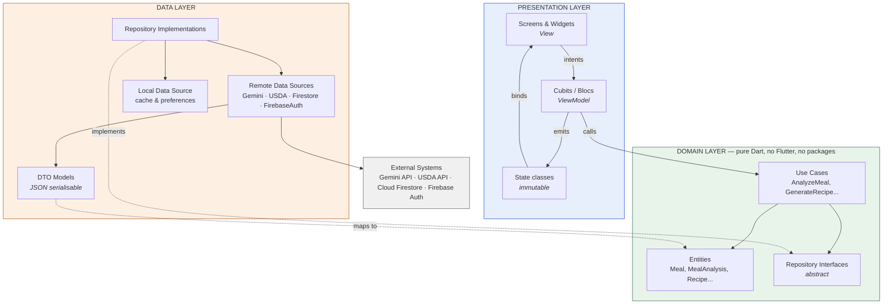
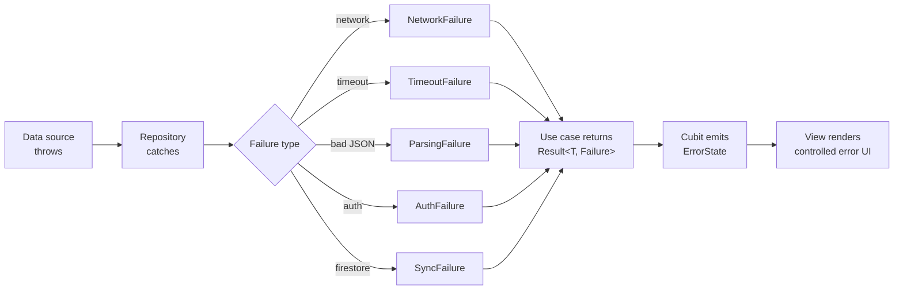

# 4. Software Architecture

> Deliverable §4.1 (partial) of the trainer's guidelines. GitHub issue #4.
> **Status: `[P]` Proposed.** Per issue #1, architecture and technology choices remain *Proposed* until the team explicitly approves them.

---

## 4.1 Architectural style

**MVVM realised with BLoC/Cubit, over a three-layer Clean Architecture separation.** `[E: team decision, 2026-11-04]`

The two terms describe different axes and are not in conflict:

- **MVVM** describes the *presentation* relationship: a View (Flutter widget) binds to a ViewModel that exposes state and receives intents, with no logic in the View.
- **Cubit is the ViewModel.** A `Cubit<State>` exposes an immutable state object and methods that the View calls; `BlocBuilder` performs the binding. This is MVVM with Cubit in the ViewModel role — the Flutter-idiomatic expression of the pattern.
- **Clean layering** describes the *dependency* relationship across the whole codebase: presentation → domain ← data, with the domain depending on nothing.

This directly satisfies **NFR-10** (business logic separated from UI) and **NFR-11** (modular organization).

**Cubit over full Bloc.** Cubit is proposed as the default because the screens are driven by direct user intents (submit a meal, request a recipe) rather than complex event streams, and Cubit's lower ceremony suits a five-person team on a training timeline. Full `Bloc` may be used where a screen genuinely needs event transformation — debouncing on `NutritionalLookupScreen` (UC-08) is the one likely candidate, where `EventTransformer` with `debounce` is cleaner than hand-rolled timers. `[P]`

---

## 4.2 Layer diagram



**The dependency rule.** Arrows point inward. The domain layer imports nothing from presentation or data — not even `flutter/material.dart`. The data layer depends on the domain only to implement its interfaces. This is what makes the domain unit-testable without a Flutter binding, which is the basis of the testing plan (`11-testing-and-validation.md`) and of KPI-04.

**How NFR-12 is satisfied.** Adding barcode scanning or image recognition later means adding a new data source and a new use case. The `MealRepository` interface and the `Meal` entity do not change, because a barcode and a photo are both just alternative ways of producing a meal description. The architecture permits the future features without being built for them.

---

## 4.3 Proposed folder structure `[P]`

```
lib/
├── main.dart
├── app/
│   ├── app.dart                   # MaterialApp, theming, router
│   ├── router/                    # route definitions, auth guard
│   └── di/                        # dependency injection registrations
├── core/
│   ├── constants/
│   ├── error/                     # Failure types, exceptions
│   ├── network/                   # Dio client, interceptors (FR-12)
│   ├── theme/                     # Material 3 tokens, light/dark
│   ├── localization/              # ARB files, l10n (NFR-13)
│   └── utils/
├── features/
│   ├── auth/                      # UC-04          — owner: Kamel (unassigned)
│   ├── meal_analysis/             # UC-01, UC-09   — owner: Ahmed / Mahmoud
│   ├── recipe_generation/         # UC-02          — owner: Ahmed
│   ├── nutrition_lookup/          # UC-08          — owner: Mahmoud
│   ├── snack_discovery/           # UC-06          — owner: Osama
│   ├── meal_history/              # UC-03          — owner: Kamel (unassigned)
│   ├── dashboard/                 # UC-07          — owner: Bassam
│   └── dietary_profile/           # UC-05          — owner: Ahmed
└── shared/
    ├── widgets/                   # design-system components
    └── extensions/
```

Each `features/<name>/` folder contains `data/`, `domain/` and `presentation/` subfolders. **Feature folders map one-to-one onto module owners in S5**, which is deliberate: it minimises merge conflicts between five people working in parallel, and makes `CODEOWNERS` trivial to write.

---

## 4.4 Component responsibilities

| Component | Responsibility | Requirements | Owner (S5) |
|-----------|----------------|--------------|------------|
| `DioClient` + interceptors | Base URLs, timeouts, auth header injection, request/response logging, retry | FR-11, FR-12, NFR-02, NFR-04 | Mahmoud |
| `GeminiDataSource` | Prompt construction, request, JSON schema enforcement, malformed-response recovery | FR-02, FR-03, FR-04 | Ahmed |
| `NutritionDataSource` `[U]` | Food search and reference nutrition lookup | FR-01 (assist), UC-08 | Mahmoud |
| `FirestoreDataSource` | Reads/writes of meals, recipes, bookmarks, profile; stream subscriptions | FR-07, FR-08, FR-10 | Kamel — **unassigned** |
| `AuthDataSource` | Email/password and Google Sign-In; session and UID | FR-16…FR-19 | Kamel — **unassigned** |
| `LocalCacheDataSource` | Offline meal queue, cached lookups, preferences | NFR-08, UC-03 A1 | Kamel — **unassigned** |
| `MealRepository` | Orchestrates analysis + persistence; maps DTOs to entities; maps exceptions to `Failure` | FR-01…FR-03, FR-07 | Shared |
| `RecipeRepository` | Recipe generation and saved recipes | FR-04, FR-05, FR-06 | Ahmed |
| `NutritionCalculator` | Daily calorie/macro summation, target progress | FR-09 | Bassam |
| Design system widgets | Shared components, dark/light tokens, responsive scaling | FR-13, NFR-01 | Bassam |

---

## 4.5 Error handling strategy `[P]`

A single strategy across the app, required by FR-11, FR-15, NFR-08 and NFR-09.



Exceptions never cross the repository boundary. Use cases return a result type carrying either a value or a typed `Failure`, so every call site is forced by the compiler to handle the failure case — which is how NFR-08 ("without crashing") is enforced structurally rather than by discipline.

**Failure to message mapping** is localised (NFR-13) and lives in the presentation layer, never in the domain.

---

## 4.6 Proposed technology decisions

All `[P]`, pending team approval.

| Concern | Proposal | Rationale |
|---------|----------|-----------|
| State management | `flutter_bloc` (Cubit default) | Team decision 2026-11-04 |
| Dependency injection | `get_it` + `injectable` | Keeps the domain free of a framework; simple for a small team |
| HTTP | `dio` | Mandated by FR-12 and S1 OBJ-08 |
| Routing | `go_router` | Declarative, supports the auth redirect guard needed by UC-04 |
| Value equality | `equatable` | Required for correct Cubit state comparison and NFR-01 (avoiding rebuilds) |
| Immutable models | `freezed` + `json_serializable` | Sealed state/failure unions; generated JSON for Gemini schema enforcement |
| Local cache | Firestore offline persistence + `shared_preferences` | Firestore's built-in persistence already covers the offline meal queue; avoids adding a second database |
| Charts | `fl_chart` | For FR-09 progress rings and macro breakdowns |
| Localization | `flutter_localizations` + ARB | Standard approach for NFR-13 |

> **Note on `freezed`.** It is listed because Ahmed's module must enforce "strict JSON output schemas for recipes" (S5). Generated `fromJson` with explicit failure on schema mismatch is what makes UC-01 A3 (malformed AI response) detectable rather than silently producing a half-empty object.

---

## 4.7 Architectural risks

| Risk | From | Mitigation |
|------|------|------------|
| API key extractable from the client binary | NFR-03 conflict, §3.5 | Decide OI-07. Recommended: accept Option A with the limitation documented. |
| Unassigned data layer | OI-05 | Three data sources and one repository have no owner. Reassign before implementation begins. |
| Gemini latency dominates perceived performance | S1 §4 risk; KPI-01 | Loading states (FR-15), controlled timeouts (NFR-02), optimistic UI where safe |
| Inaccurate AI nutritional output | S1 §4 (Medium/High) | Controlled prompts, schema validation, informational disclaimers — issue #1 excludes allergen-safety guarantees and medical advice |
| Scope expansion | S1 §4 (High probability) | `01-problem-objectives-scope.md` §1.3.3 is the operative scope definition |
