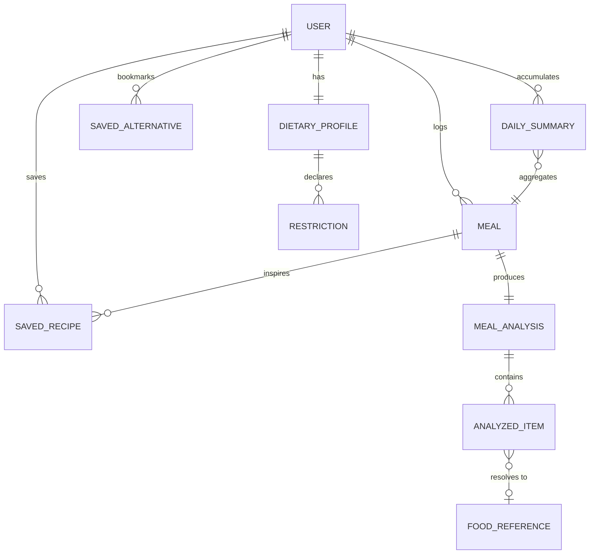

# 5. Database Design & Data Modeling

> Deliverable §4.2 of the trainer's guidelines. GitHub issue #5.
> **Status: `[P]` Proposed in its entirety, pending team approval.**

---

## 5.1 Preface — why this whole document is Proposed

No entity, attribute, key or relationship is defined anywhere in S1, S2 or S3. The evidence base describes *behaviour* (FR-01…FR-15) and *screens* (S5), never *data*.

Issue #1 instructs: *"do not invent entities, APIs, actors, or states."* This document therefore does not present a data model as agreed fact. Every entity below is **derived from a stated requirement and cites it**, and the whole model carries `[P]`. The team must approve or amend it before issues #6, #7 and #9 build on it.

Attribute-level detail is the weakest part of the derivation — requirements imply that a meal has calories, not that the field is named `calories` and typed `int`. Those choices are the author's and are marked as such.

---

## 5.2 Addressing the rubric mismatch

The trainer's guidelines (S4 §4.2) ask for an *"ER Diagram showcasing database structure and relationships"* and a *"Logical & Physical Schema — Tables, attributes, keys, and normalization considerations."* That wording describes a **relational** database.

NutriVision uses **Cloud Firestore**, a document store (FR-10, OBJ-07). It has no tables, no joins, no foreign-key constraints, and denormalization is a correct design choice rather than a defect.

Issue #1 resolves this explicitly: provide a **conceptual/logical ER model** *and* a **physical Firestore mapping**, and do not describe Firestore collections as relational tables. This document follows that instruction and is structured in three parts:

| Part | Rubric item it satisfies | Model |
|------|--------------------------|-------|
| §5.3 Conceptual ER | "ER Diagram" | Entities and relationships, database-neutral |
| §5.4 Logical schema | "Tables, attributes, keys" | Attributes, types, keys, normalized to 3NF — stated relationally so the rubric's normalization question can be answered |
| §5.5 Physical Firestore | "Physical schema" | Collections, documents, denormalization, indexes, security rules |

§5.6 explains, for the rubric, exactly how relational keys and normalization translate into the Firestore design — which is the part the lecturer is most likely to ask about.

---

## 5.3 Conceptual ER diagram `[P]`



### Entity derivation

Every entity must trace to a requirement. If it cannot, it does not belong in the model.

| Entity | Derived from | Evidence |
|--------|--------------|----------|
| `USER` | FR-18, UC-04 | Authentication decision 2026-11-04 |
| `DIETARY_PROFILE` | FR-05, US-03, UC-05 | `[E: S3]` |
| `RESTRICTION` | FR-05; "allergen toggles" | `[E: S3, S5]` |
| `MEAL` | FR-01, FR-07, US-01, US-05 | `[E: S3]` |
| `MEAL_ANALYSIS` | FR-02, FR-03, US-02 | `[E: S3]` |
| `ANALYZED_ITEM` | FR-09 — charts require per-item macro breakdown | `[P]` inferred from FR-09 + S5 (Bassam: "macro breakdown charts") |
| `SAVED_RECIPE` | FR-04, US-04, UC-02 | `[E: S3]` |
| `SAVED_ALTERNATIVE` | FR-06; S5 Osama: "bookmarking", "saved healthy favorite alternatives" | `[E: S3, S5]` |
| `DAILY_SUMMARY` | FR-09; S5 Bassam: "daily total calorie/macro summation algorithms and target progress logic" | `[P]` — could be computed on read instead; see §5.5.3 |
| `FOOD_REFERENCE` | UC-08 nutrition lookup | `[U]` — **exists only if OI-04 confirms USDA FoodData Central.** If nutrition comes solely from Gemini, this entity is deleted. |

---

## 5.4 Logical schema `[P]`

Stated in relational terms so that the rubric's keys-and-normalization requirement can be answered directly. **This is not how the data is stored** — see §5.5.

**Legend:** PK = primary key, FK = foreign key.

### USER
| Attribute | Type | Key | Notes |
|-----------|------|-----|-------|
| `uid` | string | PK | Firebase Auth UID |
| `email` | string | | Unique |
| `display_name` | string | | Nullable |
| `photo_url` | string | | Nullable; from Google Sign-In |
| `auth_provider` | enum | | `password` \| `google` (FR-16, FR-17) |
| `locale` | enum | | `ar` \| `en` (NFR-13) |
| `created_at` | timestamp | | |

### DIETARY_PROFILE
| Attribute | Type | Key | Notes |
|-----------|------|-----|-------|
| `profile_id` | string | PK | |
| `uid` | string | FK → USER | 1:1 |
| `daily_calorie_target` | int | | Nullable; required by "target progress logic" (S5) |
| `protein_target_g` | int | | Nullable |
| `carb_target_g` | int | | Nullable |
| `fat_target_g` | int | | Nullable |
| `updated_at` | timestamp | | |

### RESTRICTION
| Attribute | Type | Key | Notes |
|-----------|------|-----|-------|
| `restriction_id` | string | PK | |
| `profile_id` | string | FK → DIETARY_PROFILE | |
| `type` | enum | | `allergen` \| `diet` \| `dislike` |
| `value` | string | | e.g. `peanut`, `vegetarian` |

### MEAL
| Attribute | Type | Key | Notes |
|-----------|------|-----|-------|
| `meal_id` | string | PK | |
| `uid` | string | FK → USER | FR-18 |
| `description` | string | | Natural language input (FR-01) |
| `logged_at` | timestamp | | User-facing meal time |
| `created_at` | timestamp | | Record creation |
| `meal_type` | enum | | `breakfast` \| `lunch` \| `dinner` \| `snack`; nullable |
| `sync_status` | enum | | `pending` \| `synced` \| `failed` (NFR-09, UC-03 A1) |

### MEAL_ANALYSIS
| Attribute | Type | Key | Notes |
|-----------|------|-----|-------|
| `analysis_id` | string | PK | |
| `meal_id` | string | FK → MEAL | 1:1 |
| `total_calories` | int | | FR-03 |
| `protein_g` / `carbs_g` / `fat_g` | int | | FR-09 |
| `health_assessment` | string | | US-02 — "whether it is a healthy choice" |
| `advice` | string | | FR-03 |
| `model_name` | string | | e.g. `gemini-2.0-flash` — needed for reproducibility |
| `generated_at` | timestamp | | |

### ANALYZED_ITEM
| Attribute | Type | Key | Notes |
|-----------|------|-----|-------|
| `item_id` | string | PK | |
| `analysis_id` | string | FK → MEAL_ANALYSIS | |
| `name` | string | | |
| `quantity` / `unit` | string | | |
| `calories`, `protein_g`, `carbs_g`, `fat_g` | int | | |
| `food_reference_id` | string | FK → FOOD_REFERENCE | Nullable `[U]` |

### SAVED_RECIPE
| Attribute | Type | Key | Notes |
|-----------|------|-----|-------|
| `recipe_id` | string | PK | |
| `uid` | string | FK → USER | |
| `based_on_meal_id` | string | FK → MEAL | Nullable (UC-02 step 1) |
| `title` | string | | |
| `ingredients` | string[] | | |
| `steps` | string[] | | |
| `total_calories`, `protein_g`, `carbs_g`, `fat_g` | int | | |
| `saved_at` | timestamp | | |

### SAVED_ALTERNATIVE
| Attribute | Type | Key | Notes |
|-----------|------|-----|-------|
| `alternative_id` | string | PK | |
| `uid` | string | FK → USER | |
| `craving_input` | string | | S5 — Osama's "Unhealthy Craving" card |
| `alternative_name` | string | | S5 — "Healthy AI Alternative" card |
| `calories_saved` | int | | Difference; S5 "ingredient substitution logic" |
| `saved_at` | timestamp | | |

### DAILY_SUMMARY
| Attribute | Type | Key | Notes |
|-----------|------|-----|-------|
| `summary_id` | string | PK | Composite of `uid` + `date` |
| `uid` | string | FK → USER | |
| `date` | date | | |
| `total_calories`, `protein_g`, `carbs_g`, `fat_g` | int | | FR-09 |
| `meal_count` | int | | |

### FOOD_REFERENCE `[U]`
| Attribute | Type | Key | Notes |
|-----------|------|-----|-------|
| `food_reference_id` | string | PK | USDA `fdcId` |
| `name` | string | | |
| `calories_per_100g`, `protein_per_100g`, `carbs_per_100g`, `fat_per_100g` | decimal | | |
| `cached_at` | timestamp | | |

### Normalization

The logical schema above is in **third normal form**:

- **1NF** — no repeating groups. `RESTRICTION` and `ANALYZED_ITEM` exist precisely so that lists of restrictions and food items are not stored as repeating columns on their parents.
- **2NF** — every non-key attribute depends on the whole key. The only composite key is `DAILY_SUMMARY` (`uid` + `date`), and its totals depend on both.
- **3NF** — no transitive dependencies. `ANALYZED_ITEM` stores the macros *as analyzed for that quantity*, and does not derive them from `FOOD_REFERENCE` at read time; `FOOD_REFERENCE` holds only per-100g reference values. `DAILY_SUMMARY` is a deliberate, documented exception — see §5.5.3.

---

## 5.5 Physical Firestore schema `[P]`

> Firestore is a document store. The structures below are **collections of documents**, not tables. Relationships are expressed by subcollection nesting and document-reference fields; there are no joins and no referential-integrity constraints.

### 5.5.1 Collection layout

```
users/{uid}                                   ← USER + DIETARY_PROFILE (merged)
  ├─ meals/{mealId}                           ← MEAL + MEAL_ANALYSIS + ANALYZED_ITEM (embedded)
  ├─ recipes/{recipeId}                       ← SAVED_RECIPE
  ├─ alternatives/{alternativeId}             ← SAVED_ALTERNATIVE
  └─ dailySummaries/{yyyy-MM-dd}              ← DAILY_SUMMARY

foodCache/{fdcId}                             ← FOOD_REFERENCE  [U] — shared, read-only to clients
```

**Everything user-owned lives under `users/{uid}/`.** This is the single most important decision in the physical design: it makes FR-18 and NFR-05 enforceable with one security rule rather than a per-collection ownership check, and it makes every query automatically scoped to the signed-in user.

### 5.5.2 Example documents

`users/{uid}`
```json
{
  "email": "user@example.com",
  "displayName": "Ahmed",
  "photoUrl": null,
  "authProvider": "google",
  "locale": "ar",
  "createdAt": "<serverTimestamp>",
  "dietaryProfile": {
    "restrictions": [
      { "type": "allergen", "value": "peanut" },
      { "type": "diet",     "value": "vegetarian" }
    ],
    "dailyCalorieTarget": 2000,
    "proteinTargetG": 120,
    "carbTargetG": 220,
    "fatTargetG": 65,
    "updatedAt": "<serverTimestamp>"
  }
}
```

`users/{uid}/meals/{mealId}`
```json
{
  "description": "two eggs, brown toast and a glass of orange juice",
  "loggedAt": "<timestamp>",
  "createdAt": "<serverTimestamp>",
  "mealType": "breakfast",
  "syncStatus": "synced",
  "analysis": {
    "totalCalories": 430,
    "proteinG": 22,
    "carbsG": 48,
    "fatG": 17,
    "healthAssessment": "balanced",
    "advice": "Good protein balance. Consider whole fruit instead of juice to add fibre.",
    "modelName": "gemini-2.0-flash",
    "generatedAt": "<timestamp>",
    "items": [
      { "name": "egg", "quantity": "2", "unit": "piece", "calories": 140, "proteinG": 12, "carbsG": 1,  "fatG": 10, "foodReferenceId": null },
      { "name": "brown toast", "quantity": "2", "unit": "slice", "calories": 160, "proteinG": 8, "carbsG": 28, "fatG": 2, "foodReferenceId": null },
      { "name": "orange juice", "quantity": "250", "unit": "ml", "calories": 130, "proteinG": 2, "carbsG": 19, "fatG": 5, "foodReferenceId": null }
    ]
  }
}
```

### 5.5.3 Denormalization decisions

Three deliberate departures from the 3NF logical model. Each is a documented trade-off, which is exactly what the rubric's "normalization considerations" asks for.

| # | Decision | Rationale | Cost |
|---|----------|-----------|------|
| D1 | `MEAL_ANALYSIS` and `ANALYZED_ITEM` embedded inside the meal document | A meal is never read without its analysis (UC-01 step 7, US-05). Embedding makes history a single-collection read instead of N+1 reads, directly serving KPI-01 and NFR-01. Analysis is immutable once generated, so update anomalies cannot arise. | A meal document must stay under Firestore's 1 MiB limit — trivially satisfied |
| D2 | `DIETARY_PROFILE` and `RESTRICTION` embedded in the user document | 1:1 with the user, small, and read on every AI prompt (FR-05). A separate document would double the reads on the hottest path. | Restrictions cannot be queried across users — not a requirement |
| D3 | `DAILY_SUMMARY` stored rather than computed | S5 gives Bassam "daily total calorie/macro summation algorithms." Pre-aggregating lets the dashboard (UC-07) read one document per day instead of every meal. | **Derived data can drift.** Must be written in the same transaction/batch as the meal, or recomputed on read. **If the team prefers correctness over read cost, delete this collection and compute on read — a legitimate alternative.** |

### 5.5.4 Indexes

| Query | Index |
|-------|-------|
| Meal history ordered by date (US-05) | Single-field `loggedAt` descending — automatic |
| History filtered by date range (S5: "date filtering") | Single-field `loggedAt` — automatic |
| History filtered by `mealType` **and** ordered by `loggedAt` | **Composite index required:** `mealType` ASC + `loggedAt` DESC |
| Recipes by `savedAt` | Automatic |
| Dashboard by date | Document ID is the date — direct lookup, no index |

Only one composite index is needed, and only if meal-type filtering is implemented. Declared in `firestore.indexes.json`.

### 5.5.5 Security rules `[P]`

Satisfies NFR-05 and FR-18.

```javascript
rules_version = '2';
service cloud.firestore {
  match /databases/{database}/documents {

    function isOwner(uid) {
      return request.auth != null && request.auth.uid == uid;
    }

    match /users/{uid} {
      allow read, write: if isOwner(uid);

      match /{subcollection=**} {
        allow read, write: if isOwner(uid);
      }
    }

    match /foodCache/{fdcId} {
      allow read: if request.auth != null;
      allow write: if false;            // server-populated only
    }
  }
}
```

The recursive wildcard means every present and future subcollection under a user is owner-scoped by default — new features cannot accidentally ship with open data.

---

## 5.6 How the relational concepts map to Firestore

Written for the rubric. The lecturer's marking scheme asks about keys, relationships and normalization; this section answers each in Firestore terms.

| Relational concept | Firestore realisation |
|--------------------|-----------------------|
| **Primary key** | The document ID. Auto-generated for meals, recipes and alternatives; the Firebase Auth UID for users; the ISO date string for daily summaries (a natural key). |
| **Foreign key** | Path containment. `users/{uid}/meals/{mealId}` *is* the `uid → meal` relationship — the parent key is part of the child's address, so the relationship cannot be orphaned by a bad write. |
| **Referential integrity** | **Not enforced by the database.** Firestore has no `ON DELETE CASCADE`. Deleting a user does not delete subcollections; that must be done explicitly by the client or a Cloud Function. This is a real difference from a relational database and is listed as an implementation obligation, not glossed over. |
| **1:1 relationship** | Embedded map (`user.dietaryProfile`, `meal.analysis`). |
| **1:N relationship** | Subcollection (`users/{uid}/meals`) when children are many or queried independently; embedded array (`analysis.items`) when children are few, bounded, and only ever read with the parent. |
| **M:N relationship** | None exists in this model. |
| **JOIN** | Not available. Eliminated by embedding (D1, D2) so that no screen requires one. |
| **Normalization** | The logical model is 3NF (§5.4). The physical model denormalizes in three documented places (§5.5.3) to reduce read count. In a document store this is a correct optimisation, not a violation — the trade-off is accepted knowingly and only where data is immutable (D1), 1:1 (D2), or re-derivable (D3). |

---

## 5.7 Dependencies on open items

| Open item | Effect if resolved differently |
|-----------|-------------------------------|
| **OI-04** — USDA FoodData Central unconfirmed | `FOOD_REFERENCE`, `foodCache/`, and `foodReferenceId` are all deleted if nutrition comes only from Gemini |
| **OI-05** — Kamel's module unassigned | The entire Firestore layer has no implementer |
| **OI-08** — no data-retention or deletion requirement exists anywhere in the evidence base | Account deletion, and the cascade obligation noted in §5.6, are undefined |
