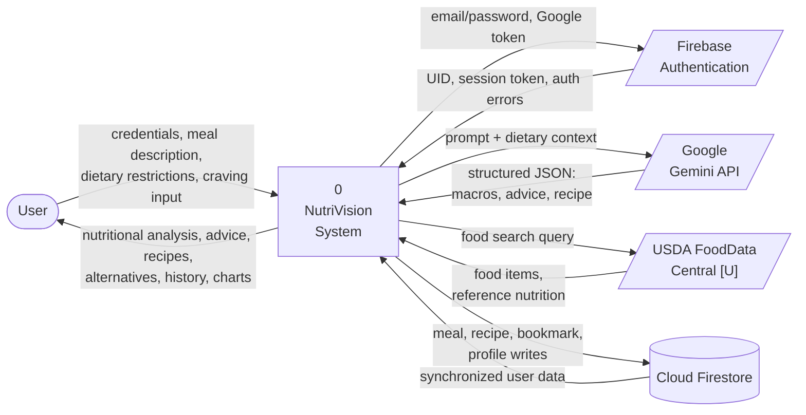
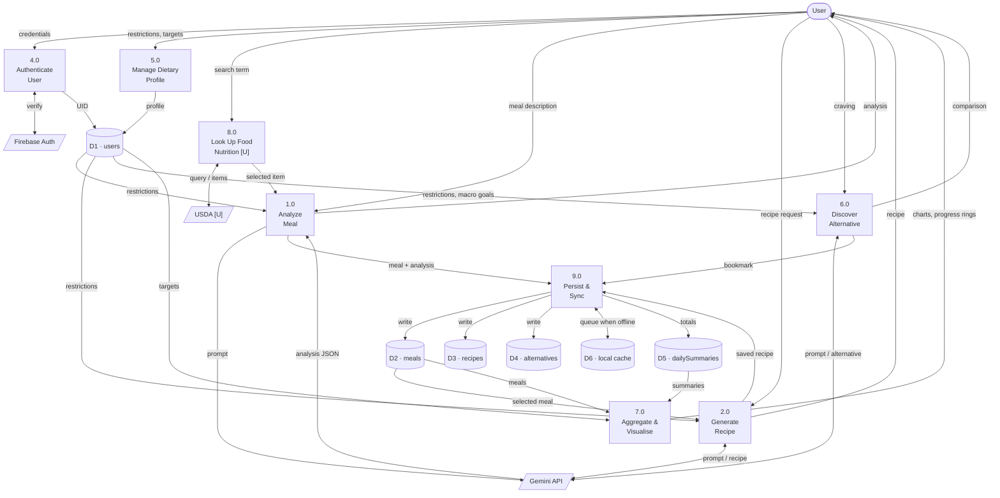
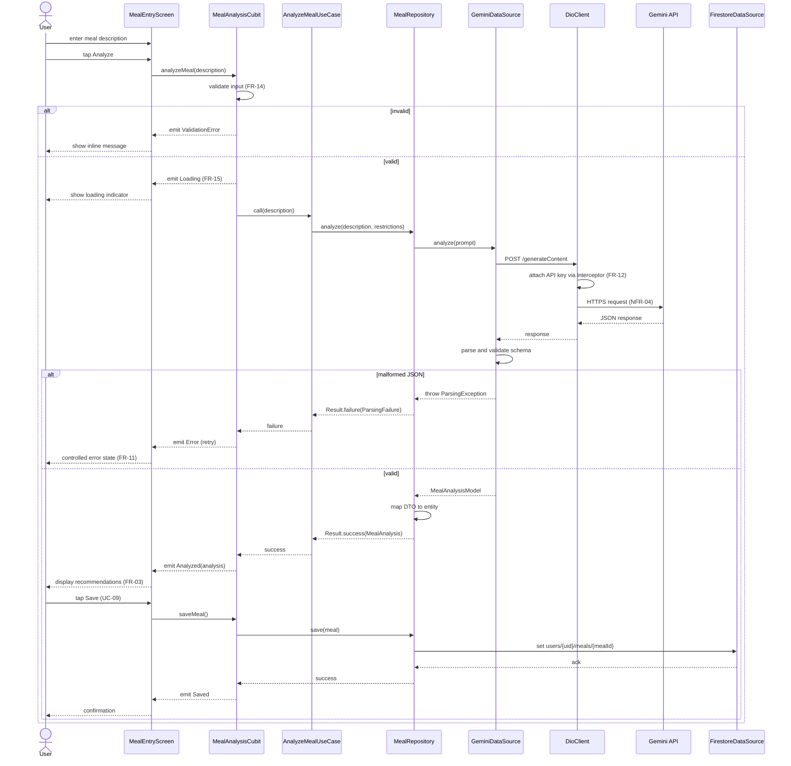
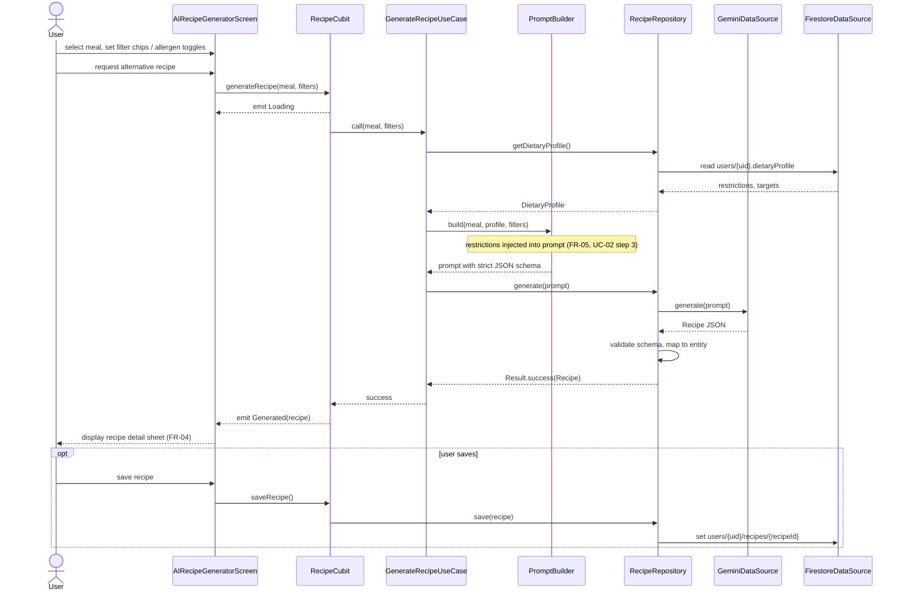
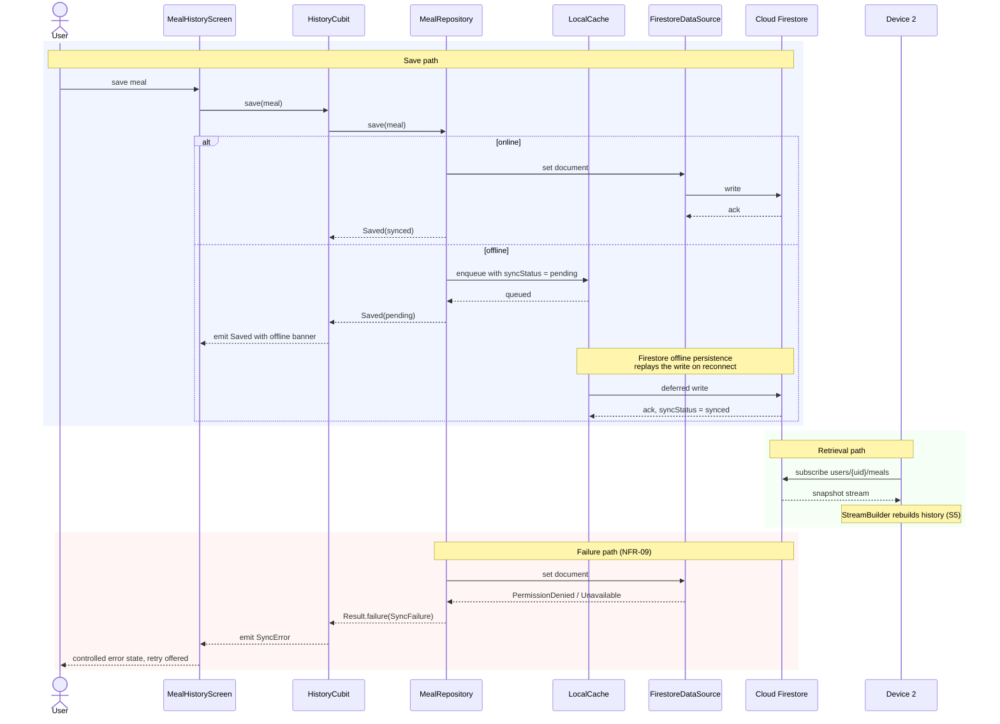
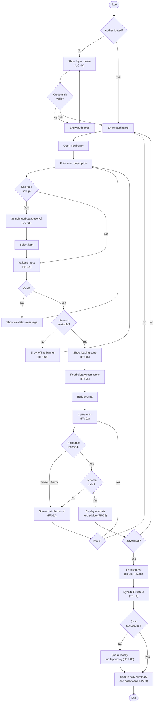
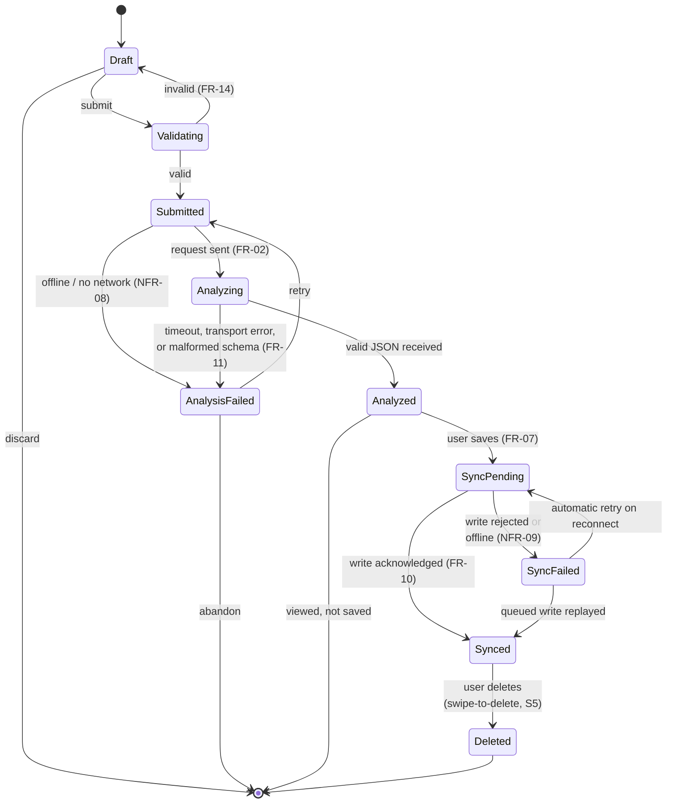

# 6. Data Flow & System Behaviour

> Deliverable §4.3 (partial) of the trainer's guidelines. GitHub issue #6.
> Diagrams are `[P]`; the flows they depict are `[E]` where traced to UC-01, UC-02 and UC-03 in S3.

---

## 6.1 Context-level data flow diagram (DFD Level 0)

The whole system as one process, with its external entities and the data crossing each boundary.

---

## 6.2 Level-1 data flow diagram

The system decomposed into its major processes and data stores. Process numbering follows the use cases.

**Reading the diagram.** Process 9.0 is the single write path to Firestore — every persisting process routes through it rather than writing directly. That is what makes the offline queue (D6) and `syncStatus` handling work in one place (UC-03 A1, NFR-09) instead of being reimplemented per feature.

---

## 6.3 Sequence diagrams

### 6.3.1 UC-01 — Analyze Meal

Traces S3's eight-step main flow across the architectural layers in `04-software-architecture.md`.

### 6.3.2 UC-02 — Generate Alternative Recipe

### 6.3.3 UC-03 — Synchronize Meal History

Includes the offline path, which is the part of UC-03 that S3 states as a requirement (NFR-08) but not as a flow.

---

## 6.4 Activity diagram — meal logging and analysis

The end-to-end user workflow, including the decision points that S3 states as requirements (FR-14, FR-11, FR-15).

---

## 6.5 State diagram — meal record lifecycle

> **Object modelled:** a `Meal` record, from first keystroke to synchronized storage.
>
> `[P]` **No state model exists anywhere in the evidence base.** Issue #1 forbids inventing states. Every state below is therefore derived from a stated requirement and cited; the *set* of states is proposed and requires approval. The `syncStatus` field in `05-data-model.md` persists the three terminal sync states.

### State derivation

| State | Derived from |
|-------|--------------|
| `Draft` | UC-01 step 2 — user enters description |
| `Validating` | FR-14 / UC-01 step 4 |
| `Submitted` | UC-01 step 3, step 5 |
| `Analyzing` | UC-01 step 6 — AI analyzes the meal; FR-15 requires this be visible |
| `Analyzed` | UC-01 step 7, postcondition |
| `AnalysisFailed` | FR-11; S5 "error recovery for malformed AI responses" |
| `SyncPending` | UC-03 A1, offline cache persistence (S5) |
| `Synced` | UC-03 step 3, FR-10 |
| `SyncFailed` | NFR-09 — "controlled error states" |
| `Deleted` | S5 — Kamel's module, "swipe-to-delete" |

**Note on `Analyzed → [*]`.** A meal analyzed but not saved is discarded; UC-01 step 8 says the user *can* save, not that saving is automatic. This is why UC-09 is modelled as `«extend»` rather than part of UC-01's main flow.

---

## 6.6 Coverage

| Diagram | Requirements exercised |
|---------|------------------------|
| Context DFD | System boundary; all external integrations |
| Level-1 DFD | FR-01…FR-10, FR-16…FR-18 |
| Sequence UC-01 | FR-01, FR-02, FR-03, FR-11, FR-12, FR-14, FR-15, NFR-04 |
| Sequence UC-02 | FR-04, FR-05, FR-06 |
| Sequence UC-03 | FR-07, FR-08, FR-10, NFR-08, NFR-09 |
| Activity | FR-01…FR-03, FR-05, FR-07, FR-09…FR-11, FR-14, FR-15 |
| State | FR-02, FR-07, FR-10, FR-11, FR-14, NFR-08, NFR-09 |
