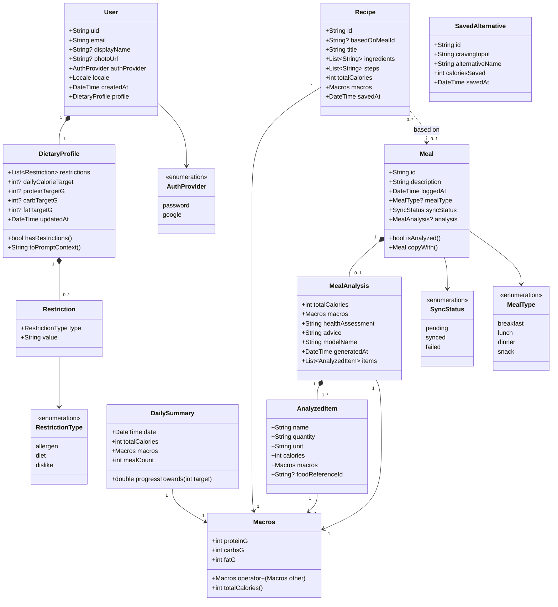
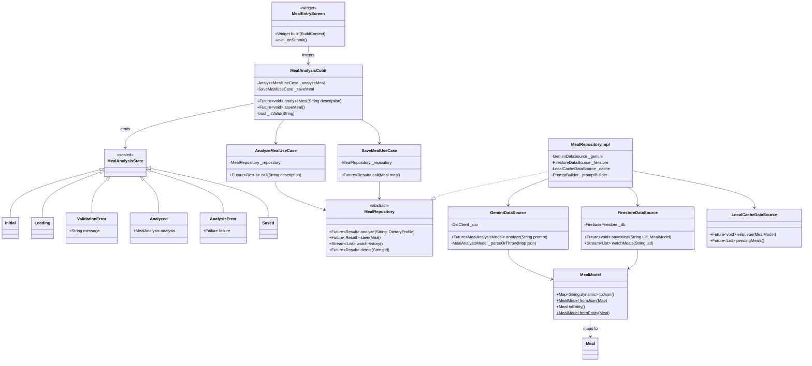
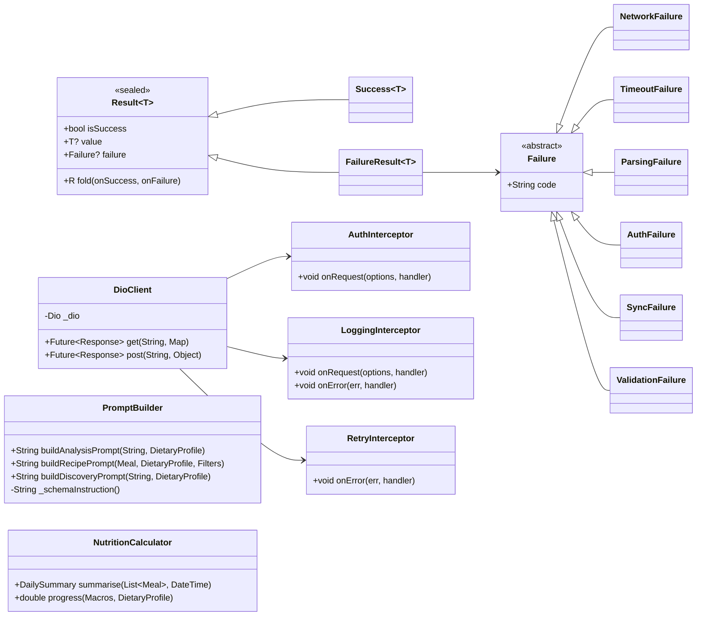

# 7. Class Diagram

> Deliverable §4.3 (partial) of the trainer's guidelines. GitHub issue #7.
> **Status: `[P]`.** Every class traces to a requirement, use case or module description. Issue #7 requires the diagram be "requirement-grounded"; §7.5 is the grounding table.

---

## 7.1 Scope of the diagram

A complete class diagram for a nine-feature application would be unreadable on one page. This document presents **three views**:

| View | Covers | Why |
|------|--------|-----|
| §7.2 Domain model | Entities and value objects | The stable core; maps 1:1 to `05-data-model.md` |
| §7.3 Meal analysis slice | Presentation → domain → data for UC-01 | The reference vertical slice every other feature copies |
| §7.4 Cross-cutting | Failures, result type, network, prompt building | The shared infrastructure of `04-software-architecture.md` §4.5 |

Dart conventions: `+` public, `-` private (leading underscore in source), `«abstract»` for interfaces. Entities are immutable — all fields are `final`, with `copyWith` where mutation is needed.

---

## 7.2 Domain model

**Design notes.**

- **`Macros` is a value object, not four loose integers.** It appears on `MealAnalysis`, `AnalyzedItem`, `Recipe` and `DailySummary`. Defining `operator+` is what makes Bassam's "daily total calorie/macro summation" (S5) a fold over a list rather than four parallel accumulators — fewer places for an arithmetic bug, and directly unit-testable for KPI-04.
- **`DietaryProfile.toPromptContext()`** is the single place restrictions become prompt text. FR-05 requires restrictions be considered in UC-02 *and* UC-06; putting the conversion on the entity stops two features drifting apart.
- **Composition (filled diamond) is used where `05-data-model.md` embeds** — `User ∘ DietaryProfile`, `Meal ∘ MealAnalysis`. The class diagram and the physical schema agree by construction.

---

## 7.3 Meal analysis vertical slice

The reference pattern. Every other feature follows the same shape with different names.

**The dependency rule, visible.** `AnalyzeMealUseCase` depends on the abstract `MealRepository`, never on `MealRepositoryImpl`. The arrow from implementation to interface points *into* the domain. This is what lets `11-testing-and-validation.md` unit-test every use case with a mock repository and no Flutter binding — the mechanism behind KPI-04 and NFR-10.

---

## 7.4 Cross-cutting classes

`PromptBuilder` is deliberately one class serving all three AI features. S5 splits prompt work across Ahmed (recipes) and Osama (discovery); a shared builder with three methods keeps the strict-JSON schema instruction in one place, so a schema fix benefits both.

---

## 7.5 Requirement grounding

Issue #7 requires the class diagram be grounded in requirements. No class exists without a line in this table.

| Class | Grounded in |
|-------|-------------|
| `User`, `AuthProvider` | FR-16, FR-17, FR-18 `[P]`; UC-04 |
| `DietaryProfile`, `Restriction`, `RestrictionType` | FR-05, US-03, UC-05; S5 "allergen toggles" |
| `Meal`, `MealType`, `SyncStatus` | FR-01, FR-07, FR-10, US-01, US-05; `06` §6.5 state model |
| `MealAnalysis` | FR-02, FR-03, US-02 |
| `AnalyzedItem` | FR-09 — per-item macro breakdown for charts |
| `Macros` | FR-09; S5 Bassam "calorie/macro summation algorithms" |
| `Recipe` | FR-04, US-04, UC-02 |
| `SavedAlternative` | FR-06; S5 Osama "saved healthy favorite alternatives" |
| `DailySummary` | FR-09; S5 Bassam "target progress logic" |
| `MealEntryScreen` and other screens | S5 screen ownership; FR-13 |
| `*Cubit`, `*State` | Team decision 2026-11-04 (Bloc/Cubit); NFR-10 |
| `*UseCase` | NFR-10 — business logic separated from UI |
| `*Repository` / `*RepositoryImpl` | NFR-10, NFR-11, NFR-12 |
| `GeminiDataSource` | FR-02, FR-03, FR-04; team decision (Gemini) |
| `FirestoreDataSource` | FR-10, OBJ-07 |
| `LocalCacheDataSource` | NFR-08; S5 "local cache persistence for offline meal entry" |
| `DioClient`, `AuthInterceptor`, `LoggingInterceptor`, `RetryInterceptor` | FR-12, NFR-02, NFR-04; S1 OBJ-08; S5 Mahmoud's module |
| `MealModel` and other DTOs | S5 Mahmoud "parses external JSON payloads into strongly-typed Dart models" |
| `PromptBuilder` | FR-05; S5 Ahmed "prompt templates enforcing strict JSON output schemas" |
| `NutritionCalculator` | FR-09; S5 Bassam |
| `Result`, `Failure` hierarchy | FR-11, FR-15, NFR-08, NFR-09; `04` §4.5 |

**Classes deliberately absent.** No `FoodReference` class is shown, because it depends on OI-04. No notification, sharing, export, or profile-photo classes exist — nothing in the evidence base requires them, and issue #1 forbids inventing them.
