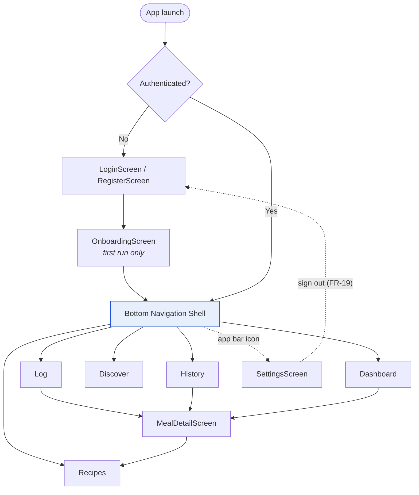

# 8. UI/UX Design & Prototyping

> Deliverable §4.4 of the trainer's guidelines. GitHub issue #8.
> **Status: `[P]`.** Issue #1 requires Flutter Material 3 be recommended *pending team approval* and that proposed UI choices not be presented as approved.

---

## 8.1 Design baseline

| Decision | Value | Status |
|----------|-------|--------|
| Design system | **Material 3** (`useMaterial3: true`) | `[P]` per issue #1 |
| Themes | Light and dark, token-driven | `[E: S5 — Bassam, "dark/light theme tokens"]` |
| Languages | Arabic and English, full RTL mirroring | `[E: team decision 2026-11-04]`; NFR-13 |
| Primary platform | Android | `[E: team decision 2026-11-04]` |
| Navigation | Bottom navigation bar, 5 destinations | `[E: team decision 2026-11-04]` |

Material 3 is recommended because it is Flutter's built-in default, gives RTL mirroring and dynamic color without custom work, and requires no third-party design dependency — relevant for a team of five on a fixed timeline.

---

## 8.2 Screen inventory

Five screens are named directly in S5 and are owned by module. Four more were confirmed by the team on 2026-11-04.

| # | Screen | Use case | Owner (S5) | Source |
|---|--------|----------|------------|--------|
| 1 | `OnboardingScreen` | UC-05 | — | `[E: team decision]` |
| 2 | `LoginScreen` / `RegisterScreen` | UC-04 | Kamel — **unassigned** | `[E: team decision]` |
| 3 | `NutritionalDashboardScreen` | UC-07 | Bassam | `[E: S5]` |
| 4 | `NutritionalLookupScreen` | UC-08, UC-01 | Mahmoud | `[E: S5]` |
| 5 | `AIRecipeGeneratorScreen` | UC-02 | Ahmed | `[E: S5]` |
| 6 | `SnackDiscoveryScreen` | UC-06 | Osama | `[E: S5]` |
| 7 | `MealHistoryScreen` | UC-03 | Kamel — **unassigned** | `[E: S5]` |
| 8 | `MealDetailScreen` | UC-01, UC-02 | — | `[E: team decision]` |
| 9 | `SettingsScreen` | UC-05, FR-19, NFR-13 | — | `[E: team decision]` |

---

## 8.3 Navigation structure



**Five tabs map one-to-one onto the five module owners in S5.** That is deliberate: each developer owns a whole tab end to end, which minimises merge conflicts and makes ownership legible. Five is also Material 3's maximum for `NavigationBar`, so the structure cannot grow without a redesign — which is itself a useful constraint given that S1 rates scope expansion as the project's highest-probability risk.

Settings is reached from the app bar, not a tab; it is low-frequency and would otherwise consume a tab slot.

---

## 8.4 Wireframes

Low-fidelity, structural. They define layout and hierarchy, not final visual design.

### 8.4.1 Dashboard — UC-07 `[Bassam]`

```
┌─────────────────────────────────┐
│  NutriVision              ⚙     │  app bar
├─────────────────────────────────┤
│                                 │
│         ╭───────────╮           │
│        │   1,240     │          │  calorie progress ring
│        │  / 2,000    │          │  (Stack + CustomPaint)
│         ╰───────────╯           │
│            62%                  │
│                                 │
│  ┌────────┬────────┬─────────┐  │  macro breakdown
│  │Protein │ Carbs  │   Fat   │  │  GridView, 3 columns
│  │ 78/120 │145/220 │  41/65  │  │  (S5: "custom GridView")
│  │ ▓▓▓░░  │ ▓▓▓▓░  │ ▓▓▓▓░   │  │
│  └────────┴────────┴─────────┘  │
│                                 │
│  Today's meals                  │
│  ┌───────────────────────────┐  │
│  │ 🍳 Breakfast      430 kcal│  │
│  │ 🥗 Lunch          610 kcal│  │
│  └───────────────────────────┘  │
│                                 │
│  ┌───────────────────────────┐  │
│  │   Last 7 days  ▁▃▅▂▇▄▆    │  │  fl_chart
│  └───────────────────────────┘  │
├─────────────────────────────────┤
│  ◉Dash  ○Log ○Rec ○Disc ○Hist   │
└─────────────────────────────────┘
```

**Empty state** (UC-07 A1): ring at zero, charts replaced by an illustration and a "Log your first meal" button routing to the Log tab.

### 8.4.2 Log / Meal entry — UC-01, UC-08 `[Mahmoud]`

```
┌─────────────────────────────────┐
│  Log a meal                     │
├─────────────────────────────────┤
│  ⚠ You are offline              │  offline banner (S5)
├─────────────────────────────────┤
│  ┌───────────────────────────┐  │
│  │ Describe your meal…       │  │  multiline, FR-01
│  │                           │  │
│  └───────────────────────────┘  │
│  ⚠ Please describe your meal    │  validation (FR-14)
│                                 │
│  Or search a food         [U]   │
│  ┌───────────────────────────┐  │
│  │ 🔍 chicken breast         │  │  debounced, UC-08
│  └───────────────────────────┘  │
│  ┌───────────────────────────┐  │
│  │ Chicken breast, raw       │  │  live suggestions (S5)
│  │ Chicken breast, grilled   │  │
│  └───────────────────────────┘  │
│                                 │
│  Meal type:  ◉Brk ○Lun ○Din ○Sn │
│                                 │
│  ┌───────────────────────────┐  │
│  │        Analyze            │  │
│  └───────────────────────────┘  │
├─────────────────────────────────┤
│  ○Dash  ◉Log ○Rec ○Disc ○Hist   │
└─────────────────────────────────┘
```

**Loading state** (FR-15): button becomes a progress indicator, field disabled, cancel available.
**Error state** (FR-11): inline card with the failure message and a Retry action — never a raw exception string.

### 8.4.3 Meal detail — UC-01 result

```
┌─────────────────────────────────┐
│  ←  Breakfast                   │
├─────────────────────────────────┤
│  "two eggs, brown toast and a   │
│   glass of orange juice"        │
│                                 │
│  ┌───────────────────────────┐  │
│  │  430 kcal      ● Balanced │  │  healthAssessment
│  │  P 22g · C 48g · F 17g    │  │
│  └───────────────────────────┘  │
│                                 │
│  Breakdown                      │  AnalyzedItem list
│  • Egg ×2            140 kcal   │
│  • Brown toast ×2    160 kcal   │
│  • Orange juice 250ml 130 kcal  │
│                                 │
│  💡 Advice                      │  FR-03
│  Good protein balance. Consider │
│  whole fruit instead of juice   │
│  to add fibre.                  │
│                                 │
│  ┌──────────┐  ┌─────────────┐  │
│  │   Save   │  │ Healthier → │  │  UC-09   │   UC-02
│  └──────────┘  └─────────────┘  │
└─────────────────────────────────┘
```

### 8.4.4 Recipe generator — UC-02 `[Ahmed]`

```
┌─────────────────────────────────┐
│  Healthier version              │
├─────────────────────────────────┤
│  Filters                        │  dynamic filter chips (S5)
│  (Low carb)(High protein)(+)    │
│                                 │
│  Avoid                          │  allergen toggles (S5)
│  Peanut  [ON]   Dairy  [off]    │
│  Gluten  [off]  Egg    [off]    │
│                                 │
│  ┌───────────────────────────┐  │
│  │ Prompt preview            │  │  dynamic preview card (S5)
│  │ Vegetarian · no peanut ·  │  │
│  │ low carb · ~400 kcal      │  │
│  └───────────────────────────┘  │
│                                 │
│  ┌───────────────────────────┐  │
│  │      Generate recipe      │  │
│  └───────────────────────────┘  │
│                                 │
│  ╭───────────────────────────╮  │  result → bottom sheet
│  │ Veggie scramble on rye    │  │
│  │ 310 kcal · P 24 C 28 F 11 │  │
│  │ Ingredients ▾             │  │
│  │ Steps ▾                   │  │
│  │ [ Save recipe ]           │  │
│  ╰───────────────────────────╯  │
└─────────────────────────────────┘
```

### 8.4.5 Snack discovery — UC-06 `[Osama]`

```
┌─────────────────────────────────┐
│  What are you craving?          │
├─────────────────────────────────┤
│  ┌───────────────────────────┐  │
│  │ chocolate bar             │  │
│  └───────────────────────────┘  │
│                                 │
│  ┌─────────────┬─────────────┐  │  side-by-side cards (S5)
│  │  CRAVING    │ ALTERNATIVE │  │
│  │             │             │  │
│  │ Chocolate   │ Dark choc + │  │
│  │ bar         │ almonds     │  │
│  │             │             │  │
│  │ 530 kcal    │  210 kcal   │  │
│  │ Sugar 48g   │  Sugar 9g   │  │
│  │             │             │  │
│  │     😕      │     🙂      │  │
│  └─────────────┴─────────────┘  │
│        ↓ saves 320 kcal         │
│                                 │
│  [ ♡ Bookmark ]   [ ⇄ Swap ]    │
├─────────────────────────────────┤
│  ○Dash ○Log ○Rec ◉Disc ○Hist    │
└─────────────────────────────────┘
```

### 8.4.6 Meal history — UC-03 `[Kamel — unassigned]`

```
┌─────────────────────────────────┐
│  History              📅 filter │
├─────────────────────────────────┤
│  TODAY                          │  timeline (S5)
│  ┌───────────────────────────┐  │
│  │ 🍳 08:15  Breakfast       │  │  swipe-to-delete (S5)
│  │    430 kcal          ✓    │  │  ✓ = synced
│  └───────────────────────────┘  │
│  ┌───────────────────────────┐  │
│  │ 🥗 13:40  Lunch           │  │
│  │    610 kcal          ⏱    │  │  ⏱ = sync pending
│  └───────────────────────────┘  │
│                                 │
│  YESTERDAY                      │
│  ┌───────────────────────────┐  │
│  │ 🍝 19:20  Dinner          │  │
│  │    720 kcal          ✓    │  │
│  └───────────────────────────┘  │
└─────────────────────────────────┘
```

The per-row sync badge surfaces `SyncStatus` from `06` §6.5 — the user can see what has and has not reached the cloud, which is what makes NFR-09's "controlled error states" visible rather than silent.

### 8.4.7 Login — UC-04 `[Kamel — unassigned]`

```
┌─────────────────────────────────┐
│                                 │
│          NutriVision            │
│      Eat better, knowingly      │
│                                 │
│  ┌───────────────────────────┐  │
│  │ Email                     │  │
│  └───────────────────────────┘  │
│  ┌───────────────────────────┐  │
│  │ Password            👁    │  │
│  └───────────────────────────┘  │
│                                 │
│  ┌───────────────────────────┐  │
│  │         Sign in           │  │  FR-16
│  └───────────────────────────┘  │
│                                 │
│  ──────────  or  ──────────     │
│  ┌───────────────────────────┐  │
│  │  G   Continue with Google │  │  FR-17
│  └───────────────────────────┘  │
│                                 │
│  New here?  Create an account   │
└─────────────────────────────────┘
```

> No "Forgot password?" link is shown, because no such requirement exists in the evidence base — see OI-06. If approved, it belongs under the Sign in button.

### 8.4.8 Settings

```
┌─────────────────────────────────┐
│  ←  Settings                    │
├─────────────────────────────────┤
│  PROFILE                        │
│  Dietary restrictions        ›  │  UC-05
│  Daily targets               ›  │
│                                 │
│  APPEARANCE                     │
│  Language      العربية / English│  NFR-13
│  Theme         System ▾         │
│                                 │
│  ABOUT                          │
│  Nutritional information in     │  disclaimer — S1 §4
│  this app is AI-generated and   │  risk mitigation
│  is not medical advice.         │
│                                 │
│  [ Sign out ]                   │  FR-19
└─────────────────────────────────┘
```

The disclaimer is a design requirement, not decoration: S1 §4 mitigates "inaccurate AI nutritional output" with "clear informational disclaimers," and issue #1 excludes medical advice and allergen-safety guarantees from scope.

---

## 8.5 UI/UX guidelines

### 8.5.1 Color `[P]`

Material 3 generates a full tonal palette from a single seed color, in both light and dark, with contrast relationships maintained automatically.

```dart
ColorScheme.fromSeed(
  seedColor: const Color(0xFF2E7D32),   // green — nutrition/health
  brightness: Brightness.light,         // and .dark
)
```

| Role | Use |
|------|-----|
| `primary` | Primary actions: Analyze, Generate, Sign in |
| `secondary` | Filter chips, selected navigation destination |
| `tertiary` | Accent on charts |
| `error` | Validation and failure states (FR-11, FR-14) |
| `surfaceContainer` | Cards, bottom sheets |

**Semantic colors for nutrition** — applied consistently across every chart so a color means the same thing on every screen:

| Meaning | Light | Dark |
|---------|-------|------|
| Protein | `#1565C0` | `#64B5F6` |
| Carbohydrate | `#EF6C00` | `#FFB74D` |
| Fat | `#6A1B9A` | `#BA68C8` |
| Under target | `#2E7D32` | `#81C784` |
| Over target | `#C62828` | `#E57373` |

> **Color is never the only signal.** Over/under target is also shown by a label and an icon. Users with color-vision deficiency are a significant minority, and S2's grading includes accessibility considerations.

> **OI-09** — no brand palette, logo or typography has been defined by the team. The seed color above is the author's proposal.

### 8.5.2 Typography `[P]`

| Role | Style | Size |
|------|-------|------|
| Screen title | `headlineSmall` | 24 |
| Card title | `titleMedium` | 16 |
| Body | `bodyMedium` | 14 |
| Numeric emphasis (calories) | `displaySmall` | 36 |
| Caption, units | `bodySmall` | 12 |

**Font pairing for bilingual support.** Latin: **Roboto** (Material default). Arabic: **Cairo** or **Tajawal** — both have full Arabic coverage, were designed for screen use, and are available under the SIL Open Font License. Selected by locale:

```dart
TextTheme base = Theme.of(context).textTheme;
final isArabic = Localizations.localeOf(context).languageCode == 'ar';
final fontFamily = isArabic ? 'Cairo' : 'Roboto';
```

Arabic text runs taller than Latin at the same point size; Arabic styles use **1.5 line height** against 1.4 for Latin to prevent diacritics clipping.

### 8.5.3 Spacing and layout

4 dp base unit; spacing from {4, 8, 12, 16, 24, 32}. Screen padding 16 dp. Card radius 12 dp. Minimum touch target 48×48 dp.

**Responsive behaviour (FR-13, NFR-01):**

| Width | Layout |
|-------|--------|
| < 600 dp (phone) | Single column; dashboard macro grid 3 across |
| 600–900 dp (tablet) | Two columns on dashboard and history |
| > 900 dp | Content capped at 840 dp, centred |

Use `LayoutBuilder`, never `MediaQuery.size` for component decisions — a component should respond to the space it is given, not the window.

### 8.5.4 Arabic localization and RTL `[P]`

Required by issue #1 to be specified here for later Flutter implementation.

**Mechanism.** Flutter `gen_l10n` with ARB files: `lib/core/localization/app_en.arb` and `app_ar.arb`. `MaterialApp` declares `supportedLocales: [Locale('en'), Locale('ar')]` and `localizationsDelegates` including `GlobalMaterialLocalizations.delegate`, `GlobalWidgetsLocalizations.delegate` and `GlobalCupertinoLocalizations.delegate`.

**Directionality.** Flutter mirrors the layout automatically when the locale is `ar`, provided the code follows these rules:

| Rule | Why |
|------|-----|
| Use `EdgeInsetsDirectional`, never `EdgeInsets.only(left:)` | `start`/`end` mirror; `left`/`right` do not |
| Use `AlignmentDirectional` | Same reason |
| Use `Row` with `MainAxisAlignment.start` | `Row` already respects directionality |
| Mirror directional icons (back arrow, chevrons) | `Icons.arrow_back` must point right in Arabic — use `Directionality.of(context)` or the `*_outlined` directional variants |
| Do **not** mirror charts, progress rings, or logos | Data visualisations and brand marks are not directional |
| Use `Intl.plural` and `Intl.select` for counts | Arabic has six plural forms against English's two — hardcoded `"$n meals"` is wrong in Arabic |

**Numerals.** Arabic locales may render Eastern Arabic numerals (٠١٢٣). Nutritional figures use **Western numerals in both locales** for consistency with charts, via `NumberFormat` with an explicit `'en'` locale for numeric values. `[P]` — reversible if the team prefers locale-native numerals.

**Content language.** Gemini prompts must request output in the user's locale, otherwise a user reading Arabic receives English advice. The locale is passed into `PromptBuilder` (see `07` §7.4).

**Testing.** Every widget test runs in both `en` and `ar`; see `11-testing-and-validation.md`.

### 8.5.5 Accessibility `[P]`

| Consideration | Approach |
|---------------|----------|
| Contrast | Material 3 token pairs meet WCAG AA; custom chart colors verified against surface |
| Touch targets | ≥ 48×48 dp |
| Text scaling | Layouts tested to 200% scale; no fixed-height text containers |
| Screen readers | `Semantics` labels on icon-only buttons and chart summaries ("Protein, 78 of 120 grams") |
| Color independence | Every state carries an icon or label in addition to color |
| Motion | Respect `MediaQuery.disableAnimations` |

### 8.5.6 State presentation

Every data-bound screen implements four states. This is a direct expression of FR-15 and NFR-08, and is checked in review.

| State | Presentation |
|-------|--------------|
| Loading | Skeleton placeholder for content; spinner only for actions |
| Empty | Illustration, one explanatory line, one primary action |
| Error | Plain-language message, Retry, no raw exception text |
| Content | The data |

---

## 8.6 Prototype handoff

**Deliverable format.** These wireframes are structural and version-controlled. A clickable prototype is recommended but is not produced by this document.

**If a visual prototype is built**, issue #1 requires open, editable, reviewable source. Options, in order of fit:

1. **Flutter prototype** — build the nine screens as static widgets with mock data. The artefact *is* the implementation starting point, satisfies "open editable source" completely, and avoids design-to-code translation loss. **Recommended.**
2. **Figma** — faster for pure visual iteration; shareable link for the trainer; not open source but universally reviewable.
3. **Penpot** — open source and self-hostable if the "open source" requirement is read strictly.

**Handoff contents** regardless of route: this document, the token definitions in §8.5, the screen inventory in §8.2, and the state matrix in §8.5.6.

> **OI-10** — no wireframes, Figma files or screen sketches exist yet. These are the project's first.
