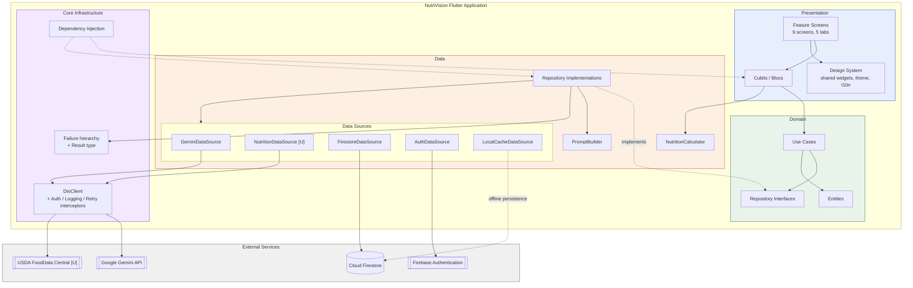
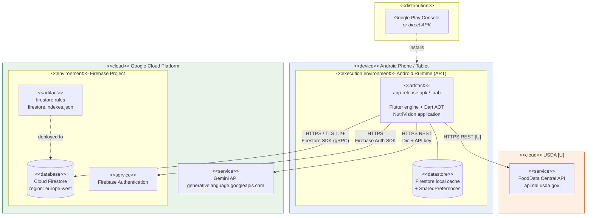
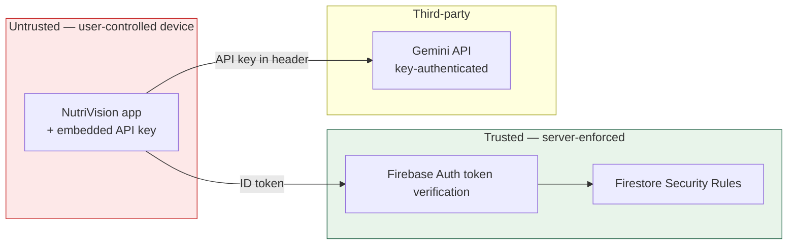

# 9. System Deployment & Integration

> Deliverable §4.5 of the trainer's guidelines. GitHub issues #4 and #9.
> Technology choices are `[P]` pending team approval.

---

## 9.1 Technology stack

### Client

| Layer | Technology | Version `[P]` | Requirement | Source |
|-------|-----------|---------------|-------------|--------|
| Framework | Flutter | 3.x stable | OBJ-01 | `[E: S1, S2]` |
| Language | Dart | 3.x | — | `[E: S2]` |
| State management | `flutter_bloc` (Cubit) | ^8.x | NFR-10 | `[E: team decision]` |
| HTTP | `dio` + interceptors | ^5.x | FR-12, OBJ-08 | `[E: S1, S2, S3]` |
| DI | `get_it` + `injectable` | ^7.x / ^2.x | NFR-11 | `[P]` |
| Routing | `go_router` | ^14.x | UC-04 guard | `[P]` |
| Models | `freezed` + `json_serializable` | ^2.x | FR-02 schema enforcement | `[P]` |
| Charts | `fl_chart` | ^0.68.x | FR-09 | `[P]` |
| Localization | `flutter_localizations`, `intl` | SDK | NFR-13 | `[E: team decision]` |
| Local storage | `shared_preferences` | ^2.x | NFR-08 | `[P]` |

### Backend services

> NutriVision has **no custom backend server**. It is a client application integrating managed services. This is a design fact worth stating explicitly, because the trainer's rubric asks for "backend, frontend, and database technologies" and the answer for the backend tier is *Backend-as-a-Service*.

| Service | Role | Requirement | Source |
|---------|------|-------------|--------|
| **Google Gemini API** | Meal analysis, recipe generation, snack alternatives | FR-02, FR-03, FR-04, FR-06 | `[E: team decision 2026-11-04]` |
| **Cloud Firestore** | Document database; multi-device sync; offline persistence | FR-07, FR-08, FR-10 | `[E: S1, S2, S3]` |
| **Firebase Authentication** | Email/password and Google Sign-In | FR-16…FR-19 | `[E: team decision 2026-11-04]` |
| **USDA FoodData Central** | Reference nutrition data and food search | UC-08 | `[U]` — **OI-04** |

### Tooling

| Purpose | Tool |
|---------|------|
| Version control | Git / GitHub — `Mahmoud-Younes/nesba_ai` `[E: S5 — Mahmoud owns repository workflow]` |
| Testing | `flutter_test`, `bloc_test`, `mocktail`, `fake_cloud_firestore`, `http_mock_adapter` `[P]` |
| Linting | `flutter_lints` `[P]` — NFR-11 |
| CI | GitHub Actions `[P]` — see `12-deployment-strategy.md` |

---

## 9.2 Component diagram

### Component dependency summary

| Component | Depends on | Depended on by |
|-----------|-----------|----------------|
| Feature Screens | Cubits, Design System | — |
| Cubits | Use Cases, NutritionCalculator | Screens |
| Use Cases | Entities, Repository Interfaces | Cubits |
| Repository Impls | Data Sources, PromptBuilder, Failures | Use Cases (via interface) |
| GeminiDataSource | DioClient | MealRepository, RecipeRepository |
| FirestoreDataSource | Firebase SDK | MealRepository, ProfileRepository |
| AuthDataSource | Firebase Auth SDK | AuthRepository |
| DioClient | Interceptors | Gemini, Nutrition data sources |
| Design System | — | All screens |

**The domain depends on nothing.** That is the property that makes the layering real rather than nominal, and it is what the architecture review in `11-testing-and-validation.md` checks.

---

## 9.3 Deployment diagram

### Deployment notes

| Aspect | Decision |
|--------|----------|
| **Target platform** | Android only for this project. iOS possible after the training assessment; not a Phase 4 commitment. `[E: team decision 2026-11-04]` |
| **Artifact** | `.aab` for Play Console; `.apk` for direct distribution and trainer demonstration |
| **Minimum SDK** | API 21 (Android 5.0) — Flutter's default `[P]` |
| **Firestore region** | `europe-west` proposed — closest low-latency region to Egypt. **`[P]` and irreversible:** a Firestore location cannot be changed after the database is created. Worth a deliberate decision before anyone clicks create. |
| **No server tier** | Nothing is self-hosted. There is no VM, container, load balancer or custom API server to deploy. |
| **Scaling** | Handled by the managed services. Firestore and Gemini scale without configuration; the application has no scaling surface of its own. |

### Trust boundaries

**Everything on the device is untrusted.** Firestore rules (`05` §5.5.5) are the only real enforcement point for FR-18 and NFR-05, because client-side checks can be bypassed. The Gemini API key sits inside the untrusted boundary — the unresolved issue recorded as **OI-07** in `03-requirements.md` §3.5.

---

## 9.4 Integration summary

| Integration | Protocol | Auth | Failure mode | Requirement |
|-------------|----------|------|--------------|-------------|
| Gemini | HTTPS REST, JSON | API key header | Timeout / malformed schema → `ParsingFailure`, retry offered | FR-02, FR-11 |
| Firestore | Firebase SDK (gRPC) | Firebase ID token | Offline queue; `SyncFailure` on reject | FR-10, NFR-09 |
| Firebase Auth | Firebase SDK | — | `AuthFailure`, re-prompt | FR-16, FR-17 |
| USDA `[U]` | HTTPS REST, JSON | API key query param | Degrade to free-text entry only | UC-08 |

All four use HTTPS, satisfying NFR-04.

**Graceful degradation.** If Gemini is unavailable, meals can still be saved without analysis. If USDA is unavailable, meal entry falls back to free text (which is the primary input path anyway, per FR-01). If Firestore is unavailable, writes queue locally. Only Firebase Auth is a hard dependency — without it there is no UID, and therefore no data scope.
