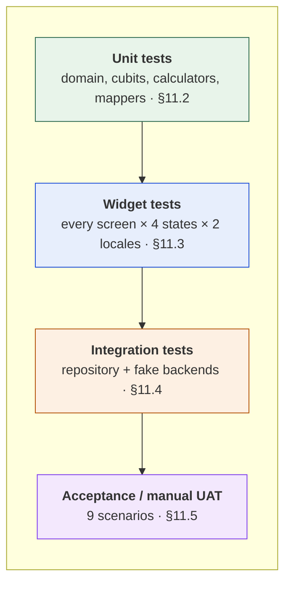

# 11. Testing & Validation Plan

> Deliverable §4.6 of the trainer's guidelines. GitHub issue #9.
> Satisfies OBJ-10. Grading weight for Testing is 10% (S2 §4); KPI-04 targets ≥ 90% pass rate.

---

## 11.1 Strategy

S1 §1 commits to **unit and widget testing** (OBJ-10), and S5 assigns Bassam to "lead Quality Assurance by writing automated Unit tests for calculations and Widget tests for UI responsiveness." The trainer's brief additionally asks for integration tests and a user acceptance plan.

**The architecture is what makes this testable.** Because the domain layer depends on nothing (`04` §4.2), every use case and every cubit can be tested with a mock repository and no Flutter binding — fast, deterministic, no network. That is the practical payoff of NFR-10, and it is why the pyramid has a wide base rather than being top-heavy with slow integration tests.

### Tooling `[P]`

| Purpose | Package |
|---------|---------|
| Test runner | `flutter_test` (SDK) |
| Cubit/Bloc testing | `bloc_test` |
| Mocking | `mocktail` |
| Firestore fake | `fake_cloud_firestore` |
| Dio mocking | `http_mock_adapter` |
| Coverage | `flutter test --coverage` + `lcov` |

---

## 11.2 Unit tests

### 11.2.1 Domain and calculations `[Bassam]`

| Target | Cases |
|--------|-------|
| `Macros.operator+` | Addition; zero identity; large values |
| `Macros.totalCalories()` | 4/4/9 kcal-per-gram arithmetic |
| `NutritionCalculator.summarise` | Empty list → zeros; single meal; multiple meals; meals spanning midnight |
| `NutritionCalculator.progress` | 0%, 50%, 100%, over-target >100%; null target → null, not divide-by-zero |
| `DietaryProfile.toPromptContext()` | No restrictions; one; many; allergen and diet mixed |
| `DietaryProfile.hasRestrictions()` | Empty vs populated |

> **`progress` with a null target is the highest-value test here.** `dailyCalorieTarget` is nullable in `05` §5.4, and an unguarded division is the most likely crash on the dashboard — directly against NFR-08 and KPI-05.

### 11.2.2 Mappers and parsing `[Mahmoud, Ahmed]`

| Target | Cases |
|--------|-------|
| `MealModel.fromJson` | Valid payload; missing required field → throws; wrong type → throws; unexpected extra field → ignored |
| `MealModel.toEntity` / `fromEntity` | Round-trip equality |
| Gemini analysis parsing | Schema-conformant response; truncated JSON; `healthAssessment` outside the enum; empty `items` array |
| Firestore timestamp mapping | `Timestamp` ↔ `DateTime`; null `serverTimestamp` during local write |

**Malformed-response tests are mandatory,** not optional: S5 makes "error recovery for malformed AI responses" an explicit responsibility, and UC-01 A3 depends on detection working.

### 11.2.3 Cubits `[each module owner]`

Using `bloc_test`, asserting emitted state sequences.

| Cubit | Expected sequence |
|-------|-------------------|
| `MealAnalysisCubit` — valid input | `Loading` → `Analyzed` |
| `MealAnalysisCubit` — empty input | `ValidationError` only, **no** `Loading`, repository never called |
| `MealAnalysisCubit` — API failure | `Loading` → `AnalysisError` |
| `MealAnalysisCubit` — malformed JSON | `Loading` → `AnalysisError(ParsingFailure)` |
| `MealAnalysisCubit` — save | `Analyzed` → `Saved` |
| `HistoryCubit` — stream emits | `Loading` → `Loaded(meals)` |
| `HistoryCubit` — sync failure | `Loaded` → `SyncError` |
| `AuthCubit` — invalid credentials | `Loading` → `AuthError` |
| `RecipeCubit` — no dietary profile | Generates without restrictions, emits a flag for the UI (UC-02 A1) |

### 11.2.4 Error mapping

Every `DioException` type maps to the correct `Failure` (`04` §4.5); no raw exception escapes a repository. Enforced by a test that asserts every repository method returns `Result` and never throws.

---

## 11.3 Widget tests

### 11.3.1 State matrix

Every data-bound screen is tested in all four states from `08` §8.5.6.

| Screen | Loading | Empty | Error | Content |
|--------|:-------:|:-----:|:-----:|:-------:|
| Dashboard | ✓ | ✓ | ✓ | ✓ |
| Meal entry | ✓ | n/a | ✓ | ✓ |
| Meal detail | ✓ | n/a | ✓ | ✓ |
| Recipe generator | ✓ | n/a | ✓ | ✓ |
| Snack discovery | ✓ | n/a | ✓ | ✓ |
| History | ✓ | ✓ | ✓ | ✓ |
| Login | ✓ | n/a | ✓ | ✓ |
| Settings | n/a | n/a | n/a | ✓ |

**Error states are tested as carefully as success states.** FR-11, FR-15, NFR-08 and NFR-09 are all requirements about failure; untested failure paths mean untested requirements.

### 11.3.2 Responsiveness `[Bassam]` — FR-13, NFR-01, KPI-06

| Test | Method |
|------|--------|
| Phone layout | `tester.binding.setSurfaceSize(Size(360, 800))` |
| Tablet layout | `Size(800, 1280)` — asserts two-column layout appears |
| Large text | `MediaQuery(textScaler: TextScaler.linear(2.0))` — asserts no overflow |
| No overflow | `expect(tester.takeException(), isNull)` after each size change |

### 11.3.3 Localization and RTL — NFR-13

**Every widget test runs twice: `Locale('en')` and `Locale('ar')`.** This is the single most effective guard for NFR-13, because RTL bugs are layout bugs that only appear when the direction flips.

| Test | Assertion |
|------|-----------|
| Arabic renders RTL | `Directionality.of(context) == TextDirection.rtl` |
| No hardcoded strings | All user-facing text resolves through `AppLocalizations` |
| Directional padding | No `EdgeInsets.only(left:)` in widget source — enforced by a lint rule, not a test |
| Arabic text does not clip | No overflow at 1.5 line height |
| Numerals consistent | Nutritional figures render identically in both locales (`08` §8.5.4) |

### 11.3.4 Accessibility

| Test | Method |
|------|--------|
| Tap target size | `meetsGuideline(androidTapTargetGuideline)` |
| Text contrast | `meetsGuideline(textContrastGuideline)` |
| Semantic labels | `meetsGuideline(labeledTapTargetGuideline)` |

These three guidelines are built into `flutter_test` and cost almost nothing to add — they turn the accessibility claims in `08` §8.5.5 into verified facts rather than intentions.

---

## 11.4 Integration tests

Repositories against fake backends — no live network, no real Firebase project.

| Test | Fakes | Verifies |
|------|-------|----------|
| Analyze → save → appears in history | `http_mock_adapter`, `fake_cloud_firestore` | UC-01 + UC-09 + UC-03 |
| Offline save then reconnect | `fake_cloud_firestore` | UC-03 A1; `syncStatus` transitions `pending → synced` |
| Sync failure | Firestore fake rejecting writes | NFR-09; `SyncError` surfaced, no crash |
| Auth guard | Mock `authStateChanges()` | Unauthenticated access redirects to login (UC-04) |
| Restrictions reach the prompt | Mock Dio, capture body | **FR-05** — asserts restriction text is present in the outgoing request |
| Key redaction | Capture log output | Interceptor redacts `api_key` / `x-goog-api-key` (`10` §10.3) |

> The FR-05 test deserves emphasis. "Dietary restrictions are considered" is easy to claim and easy to silently break — a prompt refactor that drops one line of context breaks a core requirement with no visible symptom. Asserting on the outgoing request body is the only way to know it still holds.

### Firestore security rules

Tested with the Firebase emulator against `firestore.rules` (`05` §5.5.5):

| Case | Expected |
|------|----------|
| Owner reads own meal | allow |
| Signed-in user reads another user's meal | **deny** |
| Unauthenticated read | **deny** |
| Client writes to `foodCache` | **deny** |
| Owner writes to a new subcollection under `users/{uid}` | allow — confirms the recursive wildcard |

NFR-05 and FR-18 are enforced here and nowhere else. Server-side rules are the only real boundary (`09` §9.3), so these tests carry disproportionate weight.

---

## 11.5 User acceptance testing

Manual, scenario-based, run before the final presentation. Each scenario maps to use cases and user stories.

| # | Scenario | Covers | Pass criteria |
|---|----------|--------|---------------|
| UAT-01 | Register with email, set restrictions, reach dashboard | UC-04, UC-05 | Account created; restrictions persist across restart |
| UAT-02 | Sign in with Google | UC-04, FR-17 | Session established; profile populated |
| UAT-03 | Log a meal in free text, receive analysis | UC-01, US-01, US-02 | Analysis displayed within a tolerable wait with a visible loading state |
| UAT-04 | Request a healthier recipe for that meal | UC-02, US-04 | Recipe respects stated restrictions |
| UAT-05 | Enter a craving, receive an alternative, bookmark it | UC-06, FR-06 | Comparison shown; bookmark persists |
| UAT-06 | View history, delete a meal | UC-03, US-05 | Deletion reflected immediately and after restart |
| UAT-07 | Sign in on a second device | UC-03, US-06 | History identical on both |
| UAT-08 | Enable airplane mode, log a meal, reconnect | UC-03 A1, NFR-08 | Offline banner shown; meal syncs on reconnect |
| UAT-09 | Switch language to Arabic | NFR-13 | Full RTL mirroring; no clipped or untranslated text |

**Evaluation also records** KPI-07 (user adoption / usability feedback) and KPI-08 (meal logging completion rate), both of which S1 §5 says are measured during usability evaluation.

---

## 11.6 Coverage targets and CI gate

| Layer | Target `[P]` |
|-------|--------------|
| Domain (entities, use cases) | ≥ 90% |
| Cubits | ≥ 85% |
| Repositories and mappers | ≥ 80% |
| Widgets | Every screen × 4 states × 2 locales |
| Overall | ≥ 70% line coverage |

KPI-04 requires ≥ 90% **pass rate** — a different measure from coverage. Both are reported.

**CI gate** (`12-deployment-strategy.md`): a pull request cannot merge if `flutter analyze` reports an issue or any test fails.

> **Coverage is a floor, not a goal.** 100% coverage of getters proves nothing; the FR-05 prompt test and the security-rules tests are worth more than twenty trivial ones. Reviewers should ask what a test would catch, not what it covers.

---

## 11.7 Requirement-to-test traceability

| Requirement | Verified by |
|-------------|-------------|
| FR-01 | Widget — meal entry; UAT-03 |
| FR-02, FR-03 | Unit — Gemini parsing; integration — analyze flow; UAT-03 |
| FR-04 | Integration — recipe flow; UAT-04 |
| FR-05 | **Integration — restrictions-in-prompt assertion**; UAT-04 |
| FR-06 | Integration — discovery flow; UAT-05 |
| FR-07, FR-08 | Integration — save and history; UAT-06 |
| FR-09 | Unit — `NutritionCalculator`; widget — dashboard |
| FR-10 | Integration — sync; UAT-07 |
| FR-11 | Unit — error mapping; widget — error states |
| FR-12 | Integration — interceptor and redaction |
| FR-13 | Widget — responsiveness matrix |
| FR-14 | Cubit — validation sequence; widget — validation message |
| FR-15 | Widget — loading and error states |
| FR-16…FR-19 | Cubit — auth; rules tests; UAT-01, UAT-02 |
| NFR-01 | Widget — responsiveness; rebuild inspection |
| NFR-02 | Dio timeout configuration test |
| NFR-03 | Source review; secret scanning. **Partially satisfiable only — see OI-07** |
| NFR-04 | All endpoints HTTPS — configuration assertion |
| NFR-05 | **Firestore rules emulator tests** |
| NFR-06, NFR-07 | UAT; usability evaluation |
| NFR-08 | Unit — failure paths; UAT-08 |
| NFR-09 | Integration — sync failure |
| NFR-10, NFR-11 | Architecture review; lint |
| NFR-12 | Architecture review — new data source added without domain change |
| NFR-13 | Every widget test in `ar`; UAT-09 |

Every requirement has at least one verification method. NFR-03 is the only one that cannot be fully verified, and the reason is documented rather than hidden.
