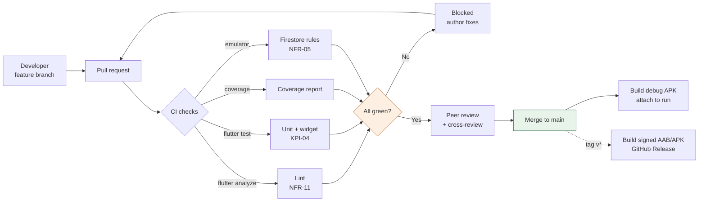

# 12. Deployment Strategy

> Deliverable §4.6 of the trainer's guidelines. GitHub issue #9.
> **Status: `[P]`.** Phase 4 produces this strategy; execution belongs to Phase 5 (Implementation, due 30 Nov 2026) and Phase 7.

---

## 12.1 Environments

| Environment | Purpose | Firebase project | Gemini key |
|-------------|---------|------------------|------------|
| **Development** | Local work; Firebase emulators for Firestore and Auth | `nutrivision-dev` | Personal/dev key, per developer |
| **Production** | Trainer demonstration and final submission | `nutrivision-prod` | Single shared project key |

Two projects rather than one. The reason is concrete: rules tests (`11` §11.4) and development experiments must not be able to corrupt the data shown in the final demonstration. A staging tier is not proposed — for a ten-week training project it is overhead without a corresponding risk.

**Flutter flavors** `[P]` separate the two:

```bash
flutter run --flavor dev  --dart-define=ENV=dev
flutter build appbundle --flavor prod --dart-define=ENV=prod --dart-define=GEMINI_API_KEY=$KEY
```

---

## 12.2 Secret management

| Secret | Development | CI / Release |
|--------|-------------|--------------|
| Gemini API key | `--dart-define` from a local untracked `.env` | GitHub Actions encrypted secret → `--dart-define` at build |
| USDA API key `[U]` | Same | Same |
| `google-services.json` | Committed per flavor — contains no secret, only project identifiers | Same |
| Android signing keystore | Not needed for debug | Base64 GitHub secret, decoded at build, never committed |

**`.gitignore` must contain** `.env`, `*.jks`, `*.keystore`, `key.properties`.

> **The known limitation.** A `--dart-define` value is compiled into the binary and is extractable from the APK. This keeps the key out of source control, which is what NFR-03 literally says, but it does not keep it out of a determined user's hands. This is **OI-07**, written up in full in `03-requirements.md` §3.5. The strategy here assumes Option A (direct client calls) and documents the limitation honestly. If the team chooses Option B, a Cloud Functions deployment step joins the pipeline and this section changes.

**If the key ever lands in a public commit** — the repository is public — rotate it immediately in Google AI Studio. Rewriting history does not help; the key is already scraped. Treat rotation, not history rewriting, as the remedy.

---

## 12.3 CI/CD pipeline



### Workflow outline `[P]`

```yaml
# .github/workflows/ci.yml
name: CI
on:
  pull_request:
    branches: [main]
  push:
    branches: [main]

jobs:
  test:
    runs-on: ubuntu-latest
    steps:
      - uses: actions/checkout@v4
      - uses: subosito/flutter-action@v2
        with: { channel: stable }
      - run: flutter pub get
      - run: dart run build_runner build --delete-conflicting-outputs
      - run: flutter analyze
      - run: flutter test --coverage
      - uses: actions/upload-artifact@v4
        with:
          name: coverage
          path: coverage/lcov.info
```

**Branch protection on `main`** `[P]`: no direct pushes, CI must pass, at least one approving review. This is how issue #1's cross-review requirement becomes enforced rather than aspirational.

### Branching `[P]`

Trunk-based with short-lived feature branches — `feature/<issue-number>-<slug>`, e.g. `feature/5-firestore-schema`. Full GitFlow is rejected deliberately: five developers on a ten-week project do not need release and hotfix branches, and the ceremony would cost more than it saves. The trainer's brief asks for a "clear workflow," which this is.

**Commit convention** `[P]`: Conventional Commits (`feat:`, `fix:`, `docs:`, `test:`, `refactor:`), referencing the issue number. Satisfies the brief's "meaningful commit messages."

---

## 12.4 Release process

| Step | Action | Owner |
|------|--------|-------|
| 1 | Version bump in `pubspec.yaml` (`x.y.z+build`) | Mahmoud |
| 2 | Full test suite green | Bassam |
| 3 | UAT scenarios (`11` §11.5) executed and recorded | Bassam |
| 4 | Tag `vX.Y.Z` | Mahmoud |
| 5 | CI builds signed AAB and APK | automated |
| 6 | Attach to GitHub Release with notes | automated |
| 7 | Verify install on a clean device | Bassam |

### Android build configuration `[P]`

| Setting | Value | Note |
|---------|-------|------|
| `minSdkVersion` | 21 | Flutter default; Android 5.0+ |
| `targetSdkVersion` | Latest stable | Play Store requirement |
| Signing | Upload keystore, CI-injected | Never committed |
| Shrinking | R8 enabled for release | Reduces size; does **not** protect the embedded key |
| Format | `.aab` for Play, `.apk` for direct install | The trainer will most likely want an APK |

> **For the trainer demonstration, produce an APK.** An AAB cannot be sideloaded directly, and the brief asks for a "compiled software or packaged application (e.g. .exe, .jar, .apk)."

---

## 12.5 Firebase deployment

| Artifact | Command | When |
|----------|---------|------|
| Firestore security rules | `firebase deploy --only firestore:rules` | On any change to `firestore.rules` |
| Composite indexes | `firebase deploy --only firestore:indexes` | On any change to `firestore.indexes.json` |

Both files are version-controlled alongside the app. **Rules and indexes are code** — reviewed, tested (`11` §11.4) and deployed, not clicked together in the console. A rules change made only in the console is invisible to the repository and will be silently reverted by the next deploy.

> **Irreversible decision.** A Firestore database's region is fixed at creation (`09` §9.3). `europe-west` is proposed for latency from Egypt. Confirm before creating the production project — changing it later means creating a new project and migrating.

---

## 12.6 Scaling

NutriVision has **no scaling surface of its own.** There is no server to scale, no instance count to tune, no load balancer. Capacity is a property of the managed services.

| Dimension | Behaviour | Constraint to watch |
|-----------|-----------|---------------------|
| Firestore reads/writes | Scales automatically | **Spark (free) plan quotas:** 50k reads, 20k writes, 1 GiB storage per day. Ample for a training project; a demonstration with many simultaneous users could brush the read quota |
| Gemini requests | Scales automatically | **Free-tier rate limits apply.** A live demonstration where several people use the app at once is the realistic risk — a 429 during the final presentation would be unfortunate |
| Auth | Scales automatically | Free tier far exceeds project needs |
| App | Per-device | None |

**Recommended mitigations for the presentation** `[P]`:
- Verify the Gemini quota before the demonstration and, if the plan allows, request an increase.
- Cache analysis results — a repeated identical meal description need not hit the API twice.
- Keep a recorded demonstration video as a fallback. The brief lists a video demonstration as optional; here it is also insurance against a live rate limit.

**Cost.** Everything fits the free tier at training scale. Firebase Blaze (pay-as-you-go) becomes necessary only if Option B in OI-07 is chosen, since Cloud Functions require it.

---

## 12.7 Phase alignment

| Phase | Due (S4) | This document's role |
|-------|----------|---------------------|
| 4 — System Analysis & Design | **6 Nov 2026** | Produce this strategy |
| 5 — Implementation | 30 Nov 2026 | Execute §12.3; CI live from the first pull request |
| 6 — Testing & QA | — | `11-testing-and-validation.md` executed in CI |
| 7 — Final Presentation | 4 Dec 2026 | Signed APK, release notes, demonstration |

> **Set up CI in the first week of Phase 5, not the last.** A pipeline added at the end catches nothing; added at the start, it is what keeps five developers' parallel work from diverging. The same applies to the Firestore rules tests — they are cheap on day one and expensive to retrofit.
