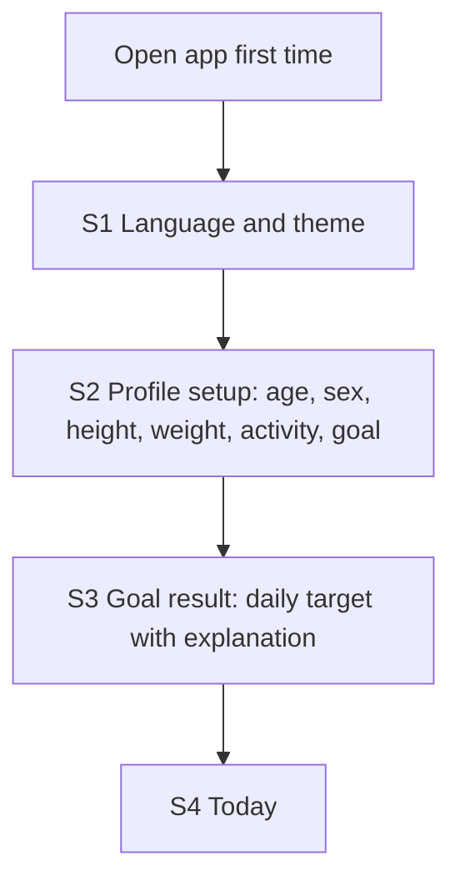
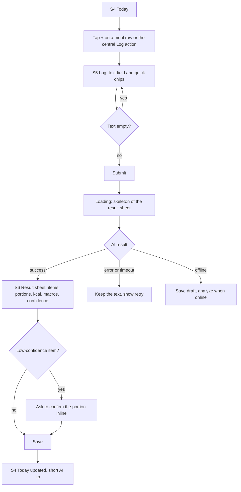
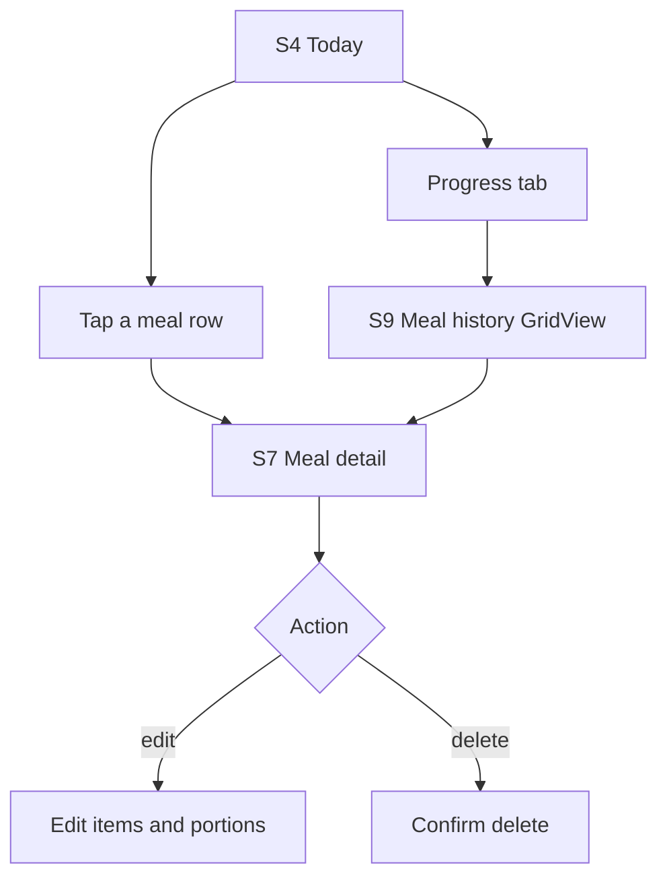
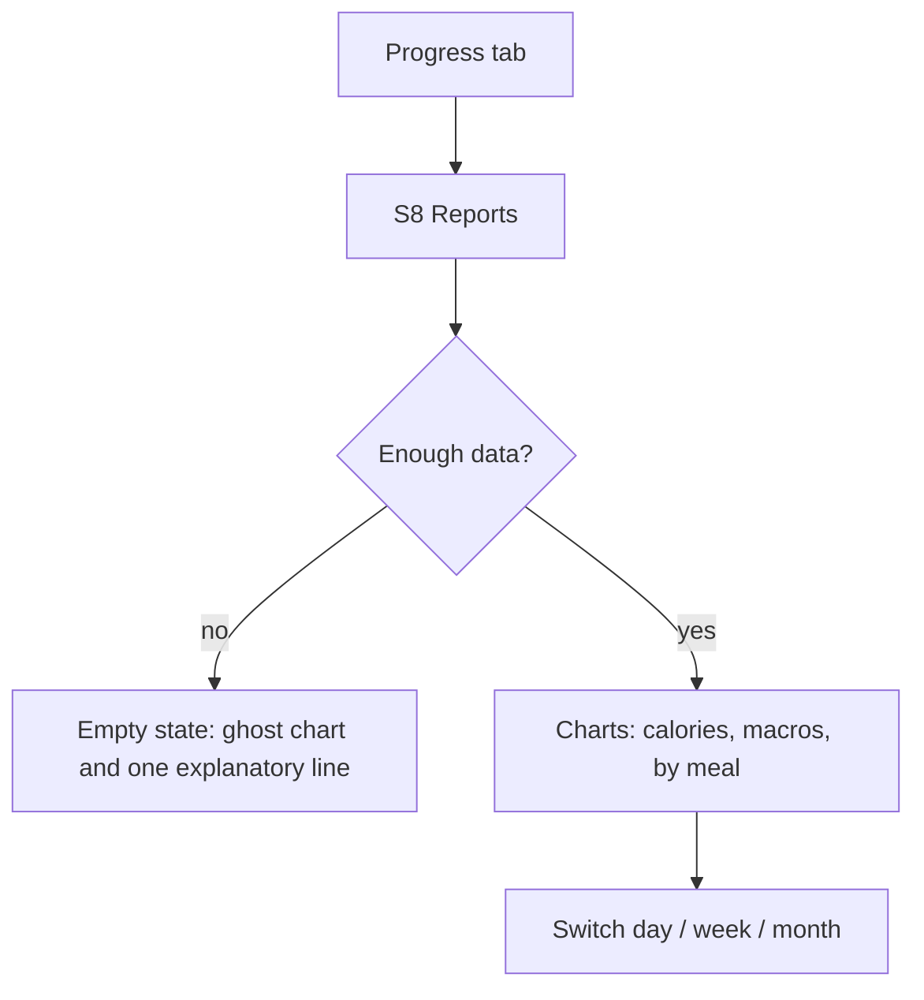
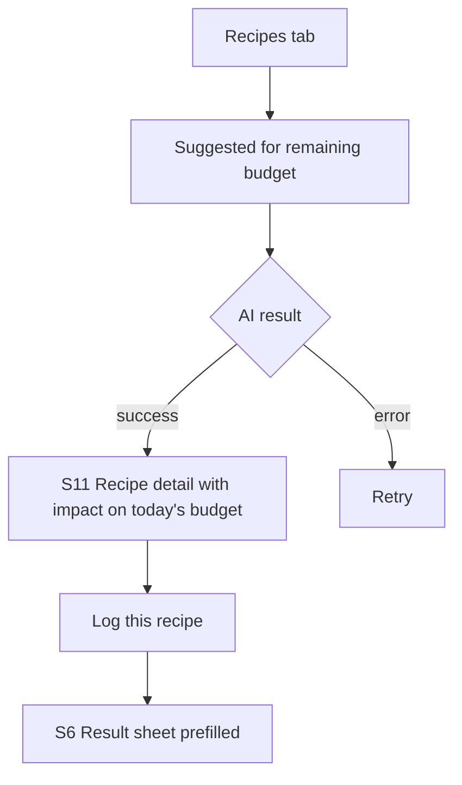
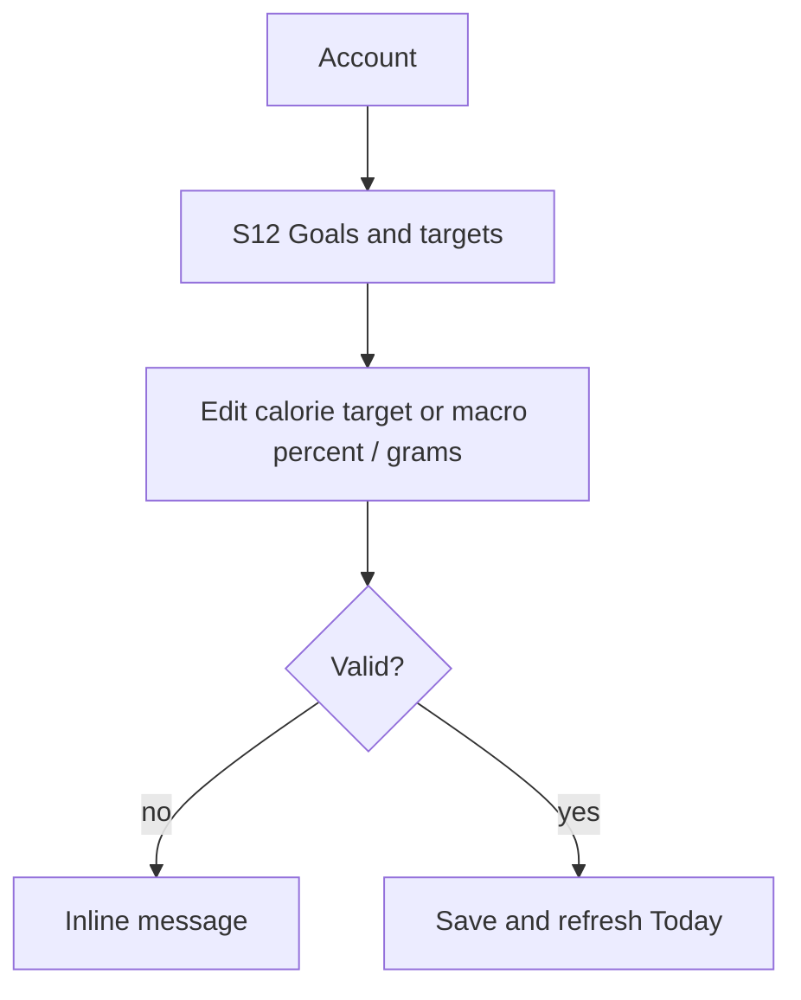

# User Flows (Proposed)

> **Status: PROPOSED.** Diagrams use Mermaid (render in GitHub, VS Code with a Mermaid extension, etc.). Screen IDs refer to `information_architecture.md`.
> Date: 2026-10-15

## F1 — First run

Notes:
- Ask only for what the calculation needs; explain why each input is requested.
- Show the explanation of the target (TDEE and adjustment) on S3, not buried in settings.
- Edge cases: invalid or extreme values → inline validation; the user skips profile → use clearly labelled defaults.

## F2 — Log a meal by text (core flow)

Edge cases to design:
- Ambiguous dish name → AI proposes 2–3 interpretations as chips.
- Very large or very small portions → highlight and ask to confirm.
- Multiple meals in one text → split into items, user assigns meal type.
- Repeated/frequent meals → quick chips from history.
- Over-goal result → calm apricot message, no red.

## F3 — Review a day and history

## F4 — Weekly progress

## F5 — AI recipe suggestion

## F6 — Edit goals

## Global states to cover in every flow

- Offline: banner + what still works.
- Sync pending / sync failed (Firestore).
- AI slow: show progress after ~2 s, allow cancel.
- AI wrong: always editable, never blocks saving.
- Permission denied (camera, notifications).
